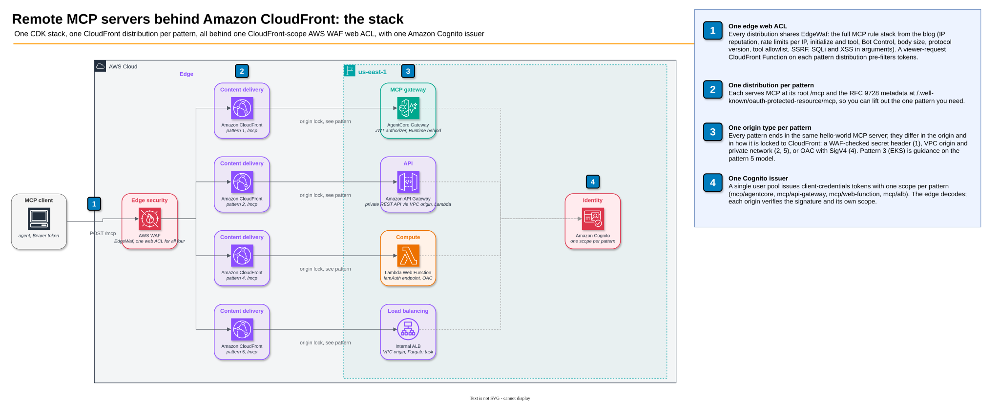
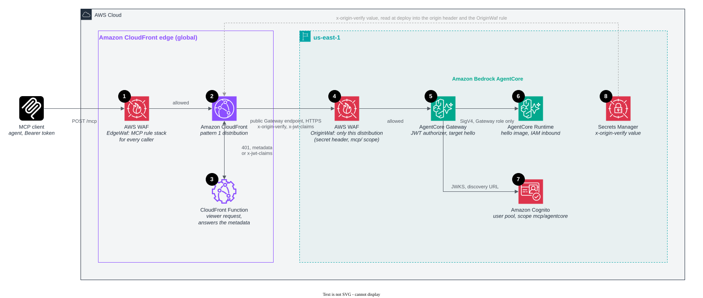
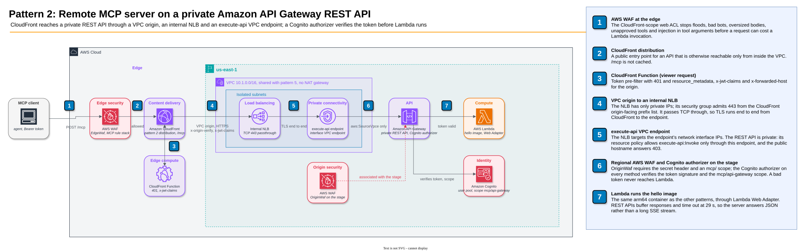
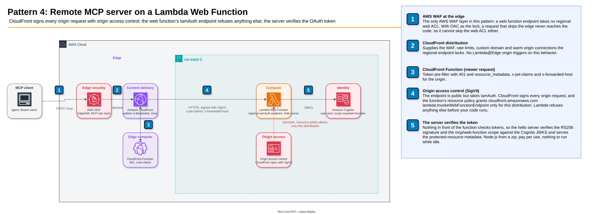
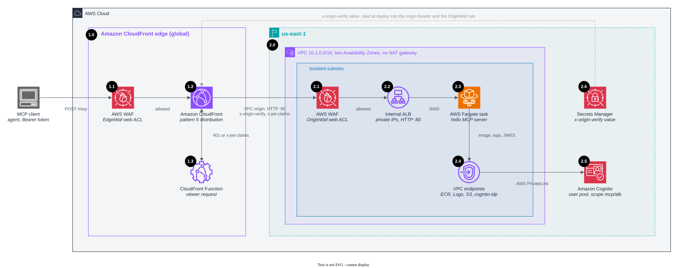

# Remote MCP servers behind Amazon CloudFront

## Why put an MCP server behind Amazon CloudFront and AWS WAF

A remote MCP (Model Context Protocol) server is a public HTTPS API with two habits of its own. Its callers are agents,
which chain calls: a search, then a read, then a lookup, each waiting for the last, so latency on every call adds up
before the agent answers. And a share of its traffic is protocol overhead with fixed answers, like liveness checks,
empty list requests and OAuth challenges, repeated every time a client connects. Agent traffic is also machine traffic
from data-center IP ranges, with credentials optional on part of the surface (discovery, the `401` challenge), so the endpoint has to stay safe
for a caller it cannot identify.

Amazon CloudFront with AWS WAF is the front door for that. Every request enters the edge location nearest the agent,
where TLS ends and where AWS WAF evaluates it before any origin or edge function runs: known-bad addresses, oversized
bodies, unapproved tools, injection in tool arguments and callers over a rate limit are turned away there. Because an
MCP call names its method and tool in the JSON-RPC body, those limits are written in the protocol's own terms (a session
open costs more than a tool call. One tool is more expensive than another) rather than as a bare request count. A
CloudFront Function then answers what needs no origin, such as the OAuth `401` challenge, and
everything else travels to the Region over connections CloudFront already holds open. The origin accepts traffic only
from CloudFront, so a request it sees carries proof that it passed every edge check.

What that buys any remote MCP server:

- **Agents finish sooner.** TLS ends near the caller, connections to the origin are reused, and protocol overhead is
  answered at the edge. An agent chaining calls saves that difference on each one.
- **The endpoint stays open and stays bounded.** AWS WAF rejects abusive and over-limit requests before the Region,
  per IP, per method and per tool, and a caller cannot route around it because the origin accepts nothing that did not
  come through CloudFront.
- **The origin handles only real work.** Protocol overhead, OAuth challenges and rejected requests end at the edge
  and cost no origin capacity.
- **Operators see all of it in one place.** CloudFront and AWS WAF metrics and logs show what the edge absorbed, which
  rule blocked what, and what reached the origin, across every edge location.

This repository shows how to build that front door for your own remote MCP server, whatever runs it.

## What this repository deploys

Five reference architectures, one per origin type, each its own CloudFront distribution serving MCP at `/mcp`
(`https://<distribution>.cloudfront.net/mcp`, metadata at `/.well-known/oauth-protected-resource/mcp`). One AWS CDK
stack deploys four of them, so you can lift out the one pattern you need. Every distribution ends in
the same hello-world MCP server, so the patterns differ only in the origin and in how CloudFront fronts it. They share
one edge: a CloudFront-scope AWS WAF web ACL with the MCP rule stack from [Protect MCP endpoints at the edge with
Amazon CloudFront and AWS WAF](https://aws.amazon.com/blogs/networking-and-content-delivery/protect-mcp-endpoints-at-the-edge-with-amazon-cloudfront-and-aws-waf/)
(see [AWS WAF at the edge](#aws-waf-at-the-edge)), a viewer-request CloudFront Function
that pre-filters OAuth tokens, and one Amazon Cognito issuer with one scope per pattern.



## Authentication

Every pattern requires an OAuth 2.0 access token from Amazon Cognito in `Authorization: Bearer`, with that pattern's
own scope: `mcp/agentcore`, `mcp/api-gateway`, `mcp/web-function` or `mcp/alb`. A token for one pattern is refused by
the others. CloudFront filters at the edge, and the origin checks the signature and the scope with its own native
verifier, so a customer who copies one pattern gets the check that pattern's origin offers.


1. **First call, no token.** The client sends `POST /mcp`. AWS WAF runs its rules, CloudFront passes the request to the
   CloudFront Function, and the function answers `401` with
   `WWW-Authenticate: Bearer resource_metadata="https://<distribution>/.well-known/oauth-protected-resource/mcp"`. The
   origin is not called.
2. **Discovery.** The client fetches that RFC 9728 document. The origin serves it (on pattern 1 the function does) and
   CloudFront caches it. It names the distribution's `/mcp` as `resource` and the Cognito user pool as its authorization
   server.
3. **Issuer metadata.** The client reads the user pool's `/.well-known/openid-configuration` to find the token endpoint.
4. **Token.** The client requests a client-credentials token with the pattern's scope (`scope=mcp/<pattern>`) and
   receives an RS256 access token. A token for one pattern is refused by the others.
5. **Authorized call.** The client repeats `POST /mcp` with `Authorization: Bearer <token>`. The function decodes the
   token, refuses it at the edge if it is malformed, expired, from another issuer or not an access token, and otherwise
   forwards the request with the decoded claims in `x-jwt-claims`. It does not check the signature.
6. **Verified at the origin.** The origin fetches the user pool's keys (JWKS), verifies the signature and its own scope,
   and answers. A token whose claims were edited after signing passes the edge and fails here.

- **The issuer.** One Cognito user pool ([lib/auth.ts](lib/auth.ts)) issues RS256 access tokens for the resource
  server `mcp`, with one scope per pattern, to one app client using the client credentials grant. The client asks for
  one pattern's scope per token request.
- **Scopes stand in for an audience.** RFC 8707 resource indicators would bind a token's `aud` to the resource URL.
  Cognito supports that (resource binding) only for user sign-in through managed login, not for client-credentials
  grants, so this sample binds each token to one pattern through its scope instead. With user sign-in, request
  `resource=<pattern URL>` and have each origin check `aud` as well.
- **The edge pre-filter.** The viewer-request CloudFront Function ([lib/viewer-request.js](lib/viewer-request.js))
  decodes the token and answers `401` for a token that is missing, malformed, expired, from another issuer, or not an
  access token. It does not check the signature: CloudFront Functions offer HMAC but no RSA verify, so an RS256 check
  at the edge would need Lambda@Edge. The pre-filter still stops most bad traffic at the edge location, at
  CloudFront Functions cost, before an origin does any work.
- **The claims header.** The function replaces any client-sent `x-jwt-claims` with the decoded claims, so the regional
  web ACL `OriginWaf` ([lib/waf.ts](lib/waf.ts)) can make resource-level decisions. `OriginWaf` allows a request only
  with CloudFront's secret `x-origin-verify` header and a `scope` that includes some `mcp/` scope. The web ACL is shared by
  every origin, so it cannot tell patterns apart. Each origin requires its own scope. A forged claims header gets past the
  edge and this rule, then fails the origin's signature check.
- **The check at each origin.**

  | Pattern | Signature checked by | Why there |
  |---|---|---|
  | 1 AgentCore | AgentCore Gateway custom JWT authorizer, with the pool's discovery URL, the client and the scope | Native to the Gateway |
  | 2 API Gateway | Cognito authorizer on every method, with the scope | Native to REST APIs. Lambda never runs for a bad token |
  | 4 Web function | The hello server ([server/auth.js](server/auth.js)) | Nothing in front of the function checks tokens |
  | 5 ALB | The hello server, which reads the keys through a `cognito-idp` VPC endpoint (no NAT) | ALB JWT verification works only on HTTPS listeners (an HTTP listener rejects the action), and an HTTPS VPC origin needs a certificate for your own domain. With one, use `ListenerAction.authenticateJwt` |

- **Discovery.** The `401` carries `WWW-Authenticate: Bearer resource_metadata="https://<distribution>/.well-known/oauth-protected-resource/mcp"`.
  Each origin serves that [RFC 9728](https://www.rfc-editor.org/rfc/rfc9728) document itself, with the distribution's
  host in `resource` (the function passes it in `x-forwarded-host`) and the Cognito issuer in `authorization_servers`.
  CloudFront caches it. AgentCore Gateway's own document names the Gateway's hostname, so on pattern 1 the CloudFront
  Function answers it instead ([pattern 1](patterns/1-agentcore/README.md#where-authentication-sits)). An MCP client follows it to the issuer's metadata and the token endpoint.
- **Getting a token.** The stack outputs `TokenUrl`, `UserPoolId` and `ClientId`. Read the client secret with
  `describe-user-pool-client` and request a client-credentials token with the pattern's scope ([Deploy](#deploy)). The
  sample's single app client holds every scope so one deployment can exercise every pattern. In production, give each
  client its own app client with only the scopes it needs.

## The five architectures

### 1. Amazon Bedrock AgentCore

CloudFront → AgentCore Gateway → AgentCore Runtime running the hello image.



The managed path. The Gateway is a public endpoint, so a regional AWS WAF web ACL on it accepts only requests carrying
CloudFront's secret `x-origin-verify` header. The Gateway's own JWT authorizer verifies the Cognito token and scope
(`mcp/agentcore`) before any target is called, and the Runtime accepts only the Gateway's role over SigV4. The
protected-resource metadata is answered by the CloudFront Function, because the Gateway's own names its hostname rather
than the distribution's. CloudFront adds a custom domain and edge WAF to a managed endpoint that has neither, and one
front door for a gateway that serves one Region. Nothing to run and no VPC. The first call after idle sees a cold start,
and tool names arrive as `<target>___<tool>` (`hello___hello`). [Details](patterns/1-agentcore/README.md).

### 2. Amazon API Gateway

CloudFront → VPC origin → internal Network Load Balancer → `execute-api` VPC endpoint → private REST API → AWS Lambda
running the hello image with Lambda Web Adapter.



A private API made reachable from the internet without exposing it. The REST API has no public endpoint: its resource
policy allows invocation only through the VPC endpoint, the NLB's security group admits only the CloudFront origin-facing
prefix list, and the stage carries the regional web ACL. The NLB passes TCP through, so TLS runs end to end from
CloudFront to the endpoint. A Cognito authorizer on every method verifies the token and scope (`mcp/api-gateway`), so
Lambda never runs for a bad token, and the edge WAF stops floods before they cost an invocation. The private path adds
fixed cost (NLB and interface endpoint in two Availability Zones), the REST API's 29-second timeout rules out long SSE
streams, and container cold starts are slower than a zip handler. [Details](patterns/2-api-gateway/README.md).

### 3. Amazon EKS

CloudFront → VPC origin → internal ALB or NLB → pods on Amazon EKS. Guidance only: the stack deploys no distribution,
because clusters differ too much (networking add-ons, ingress controllers, GitOps tooling) for one template to fit.

The design reuses pattern 5 with pods in place of the Fargate task: the AWS Load Balancer Controller provisions an
internal load balancer in private subnets, the VPC origin reaches it, the shared edge web ACL and CloudFront Function
front it, and the token is verified by the ALB (HTTPS listener), an in-cluster gateway or the server. The guide covers
the controller annotations, the security groups, the secret-header rule and the MCP-specific configuration (idle
timeouts, streaming). Uses the cluster, CI/CD and observability you already run, with no cold starts. The most to
operate, fixed cost while idle, and an origin lock that spans the cluster team's and the network team's code.
[Details](patterns/3-eks/README.md).

### 4. Lambda Web Function

CloudFront, signing with origin access control → regional endpoint of a Lambda Web Function → the hello server as a zip.



The strongest lock without a private network. The endpoint is public but takes `IamAuth`: CloudFront signs every origin
request with SigV4, and the function's resource policy grants `cloudfront.amazonaws.com` the invoke permission only for
this distribution, so Lambda refuses anything else before your code runs. Nothing in front of the function checks tokens,
so the hello server verifies the Cognito token and scope (`mcp/web-function`) itself. Pay per use with no VPC, load
balancer or NAT, and CloudFront supplies the WAF and rate limits the endpoint lacks. Node.js from a zip only, one web ACL
layer rather than two, cold starts on a new execution environment, and no Lambda@Edge origin triggers on this behavior.
[Details](patterns/4-web-function/README.md).

### 5. Application Load Balancer

CloudFront → VPC origin → internal Application Load Balancer → one AWS Fargate task, in two Availability Zones with no
NAT gateway.



The common production shape for container workloads, with no public origin to protect. The ALB has only private IPs,
its security group admits only the CloudFront origin-facing prefix list, and it carries the regional web ACL, so a
workload inside the VPC cannot skip the edge rules either. The task pulls its image and the Cognito keys through VPC
endpoints and verifies the token and scope (`mcp/alb`) itself (ALB JWT verification needs an HTTPS listener and a
certificate for your own domain). Costs while idle: the task,
the ALB and four interface endpoints. [Details](patterns/5-alb/README.md).

### Side by side

| | Pattern | MCP URL (stack output) | Origin lock | Token verified by | Deployed by the stack |
|---|---|---|---|---|---|
| 1 | [AgentCore](patterns/1-agentcore/README.md) | `AgentCoreMcp` | Shared secret, checked by a regional web ACL on the Gateway | Gateway JWT authorizer | Yes |
| 2 | [API Gateway](patterns/2-api-gateway/README.md) | `ApiGatewayMcp` | Network, resource policy and security group, plus the shared secret | Cognito authorizer | Yes |
| 3 | [EKS](patterns/3-eks/README.md) | none | Network and security group | ALB, in-cluster gateway or server | No, guidance only |
| 4 | [Web function](patterns/4-web-function/README.md) | `WebFunctionMcp` | IAM (SigV4 through OAC), enforced by Lambda | Hello server | Yes |
| 5 | [ALB](patterns/5-alb/README.md) | `AlbMcp` | Network and security group | Hello server | Yes |

[docs/comparison.md](docs/comparison.md) compares the patterns on origin lock, where auth sits, rate limiting, both
AWS WAF layers, caching, cost, cold start and what CloudFront adds. Patterns 2 and 5 share one VPC (`10.1.0.0/16`, two
Availability Zones, isolated subnets, no NAT gateway), and the regional web ACL `OriginWaf` is shared by every origin
that supports AWS WAF.

## AWS WAF at the edge

Every pattern distribution shares one CloudFront-scope web ACL, `EdgeWaf` ([lib/waf.ts](lib/waf.ts)), and every
origin that can take a web ACL (the AgentCore Gateway, the REST API stage, the ALB) also carries the regional `OriginWaf`.
AWS WAF runs before the CloudFront Function and before any origin, so a blocked request costs no origin work and no
edge-function invocation.

### Why MCP can be inspected at the edge

An MCP call over Streamable HTTP is a `POST` with a JSON-RPC body. The two facts that matter for policy, which
operation (`method`) and which tool (`params.name`), are in that body, and tool arguments sit under
`params.arguments`. AWS WAF can read JSON bodies by path, so a web ACL can allowlist tools, screen arguments and rate
limit per tool without the origin parsing anything. Edge rules cover what is visible in the request: protocol shape,
tool, arguments, source IP. They cannot verify a bearer token, so identity-based decisions (per-user limits, role-based
tool access) stay at the origin, after the token is verified.

### The edge rule stack

The rules are the nine use cases of [Protect MCP endpoints at the edge with Amazon CloudFront and AWS WAF](https://aws.amazon.com/blogs/networking-and-content-delivery/protect-mcp-endpoints-at-the-edge-with-amazon-cloudfront-and-aws-waf/),
plus two that belong in front of any public API. Those two are the Amazon managed IP reputation list, and a rate
limit scoped to a method rather than to the request count. They are examples to lift and adapt. The hello server has one tool, so the rules for `query_database` and
`execute_sql` guard tools this sample does not expose. They sit inert here and show the shape to copy when you do.
Priorities step by 10 so a rule can be inserted without renumbering. Every body-inspecting rule runs after the size
preflight, so a body the web ACL cannot fully see never reaches them.

| Priority | Rule | What it does |
|---|---|---|
| 10 | `AmazonIpReputation` | `AWSManagedRulesAmazonIpReputationList`: addresses on Amazon's threat intelligence lists are blocked before anything is counted or inspected |
| 20 | `RateLimitPerIp` | 1,000 requests per 5 minutes per IP on `/mcp` (use case 9) |
| 30 | `RateLimitInitializePerIp` | 100 `initialize` calls per 5 minutes per IP. Opening a session costs the origin more than a tool call, so the limit is scoped to the method read from the body |
| 50 | `BotControlCommon` | AWS WAF Bot Control at the `COMMON` level labels each caller: verified bot, Web Bot Auth result, cloud provider, HTTP library. Five sub-rules that would block ordinary agent traffic (`SignalNonBrowserUserAgent`, `CategoryHttpLibrary`, `SignalAutomatedBrowser`, `CategoryAI`, `SignalKnownBotDataCenter`) are overridden to Count so they still label. The volumetric, scraper and SEO rules keep blocking. Scoped to `/mcp` (use case 2) |
| 60 | `MCPBodySizePreflight` | Body over 32 KB is blocked. The web ACL inspects up to 32 KB, so every later body rule can use `OversizeHandling: NO_MATCH` (use case 3) |
| 70 | `BlockJsonRpcBatch` | JSON-RPC batches are blocked, so a `tools/call` cannot hide inside an array |
| 80 | `RequireMCPProtocolVersion` | `mcp-protocol-version` must be `2025-06-18` or `2025-11-25`. `initialize` is exempt, as the client learns the version from its response (use case 1) |
| 90 | `BlockUnapprovedMCPTools` | `tools/call` is allowed only for `hello`, or `hello___hello` as AgentCore Gateway names it. Unparseable JSON counts as an unapproved tool (use case 4) |
| 100-102 | `LabelToolHello`, `LabelToolQueryDatabase`, `LabelToolExecuteSql` | Count rules that stamp `mcp:tool:<name>` from `params.name` on a `tools/call`, one per tool in `TOOL_LABELS`. The rules below read these labels |
| 110 | `BlockUnverifiedBotOnHighCostTool` | A `tools/call` to a labeled tool from a caller whose Web Bot Auth signature is `invalid` or `unknown_bot`. In Count: soak it, watch the labels your callers pick up, then switch to Block (use case 2) |
| 120 | `BlockDestructiveSQL` | On `mcp:tool:query_database`, `DROP`, `TRUNCATE`, `ALTER`, `GRANT`, `REVOKE`, `CREATE`, `DELETE FROM`, `INSERT INTO` or `UPDATE ... SET` in `params.arguments.query`, after `COMPRESS_WHITE_SPACE` and `UPPERCASE`. A missing `query` is a match (use case 5) |
| 121 | `BlockMCPSSRF` | On a `tools/call`, any argument naming the IMDS endpoint, a cloud metadata host, `kubernetes.default`, a `.local` or `.internal` name, an IPv4 loopback, link-local or private address, or an IPv6 loopback, mapped, unique-local or link-local prefix, after one `URL_DECODE` (use case 6) |
| 122 | `MCPSQLiProtection` | On a `tools/call` not labeled `mcp:tool:execute_sql`, every string value under `params.arguments` goes through the AWS WAF SQL injection parser at sensitivity `LOW`, after `URL_DECODE`, `HTML_ENTITY_DECODE` and `LOWERCASE` (use case 7) |
| 123 | `MCPXSSProtection` | The same values through the XSS parser. `hello(name="edge")` passes. `' OR 1=1 --` and `<script>alert(1)</script>` are blocked |
| 160 | `RateLimitPerTool` | 200 requests per 5 minutes per labeled tool and IP, aggregated on the `mcp:tool:` label namespace plus the client IP, so one caller cannot spend a tool's whole budget (use case 8) |

Blocked requests get a JSON-RPC error with HTTP 403 and an `x-mcp-waf-request-id` header to correlate with the WAF
logs, except from the two AWS managed rule groups, which answer a plain 403. Try it: send `' OR 1=1 --` or
`http://169.254.169.254/` as the hello tool's argument and watch the edge block it before the origin sees it.

### The regional web ACL

`OriginWaf` defaults to block and allows a request only with CloudFront's secret `x-origin-verify` header and an `mcp/`
scope in the `x-jwt-claims` header the CloudFront Function sets from the decoded token (or the protected-resource
metadata path, which carries no token). Ahead of that allow it repeats the tool labels and the four argument rules, so
a caller inside the VPC cannot skip them. It has no size preflight and an ALB inspects only the first 8 KB of a body, so
there the argument rules treat a larger body as a match and block it. A forged `x-jwt-claims` gets past the edge and
this web ACL, then fails the origin's signature check.

### Where this differs from the blog

- The method and tool name are read from `/method` and `/params/name` in the JSON body. The blog matches `mcp-method`
  and `mcp-name` headers, which current MCP SDK clients do not send. Rate limits and label matches cannot read the
  body, so one Count rule per tool stamps `mcp:tool:<name>` first, and the per-tool rate limit aggregates on that label
  namespace rather than on an `mcp-name` header and expensive-tools pattern set.
- SQLi and XSS use the built-in `SqliMatchStatement` and `XssMatchStatement` on the JSON path rather than the managed
  `AWSManagedRulesSQLiRuleSet` and `AWSManagedRulesCommonRuleSet`: the managed groups read the raw body, where the JSON wrapper can hide an attack string, while these statements parse each argument value.

### Cost, deployment and observability

- Bot Control is billed as a subscription plus a per-request charge on top of the web ACL ([AWS WAF
  pricing](https://aws.amazon.com/waf/pricing/)). `npx cdk deploy -c botControl=false` leaves it and the composition
  rule out.
- Deploy new rules in Count first, review the sampled requests, then promote to Block one rule at a time.
  `BlockUnverifiedBotOnHighCostTool` ships in Count for that reason.
- The SSRF rule is defense in depth, not the primary control: text transformations run one pass, so decimal or octal IP
  encodings, DNS rebinding and double encoding get past it. Lock the tool executor's egress with security groups,
  IMDSv2 and VPC endpoint policies as well.
- Turn on AWS WAF logging to get a per-request record with the terminating rule and labels. The blog's CloudWatch Logs
  Insights queries (top tools, tool-enumeration spikes per IP, verified-agent × tool baseline) and the AI traffic
  analysis dashboards in the AWS WAF console work on those logs. This sample does not enable logging.

## Caching strategy

| Path | Cache policy | Why |
|---|---|---|
| `/mcp` on each pattern distribution | `CachingDisabled` | MCP calls are `POST` JSON-RPC, different per request and per caller. Every call goes to the origin |
| `/.well-known/*` on each pattern distribution | `CachingOptimized`. The origin sends `Cache-Control: public, max-age=3600` (on pattern 1 the CloudFront Function answers it, with no origin call) | Protected-resource metadata is the same for every client, and clients fetch it after every 401 |

The MCP paths still gain from CloudFront without caching: TLS ends at the edge location, and CloudFront keeps warm
connections to the origin.

## Deploy

```bash
npm ci && npx cdk deploy
npx cdk destroy
```

The edge web ACL includes AWS WAF Bot Control, which is billed on top of the web ACL ([pricing](https://aws.amazon.com/waf/pricing/)).
`npx cdk deploy -c botControl=false` leaves it out. The rule stack is documented in [AWS WAF at the edge](#aws-waf-at-the-edge).

The stack outputs one MCP URL per pattern (`AgentCoreMcp`, `ApiGatewayMcp`, `WebFunctionMcp` and `AlbMcp`, each
`https://<distribution>.cloudfront.net/mcp`) and the Amazon Cognito issuer's `TokenUrl`, `UserPoolId` and `ClientId`.

Get a token for one pattern's scope and call its tool through the distribution (the stack is `CloudFrontMcpSamples`.
Replace the scope and the `AlbMcp` output with your pattern's, and use `hello___hello` as the tool on pattern 1):

```bash
stack=CloudFrontMcpSamples scope=mcp/alb
out() { aws cloudformation describe-stacks --stack-name "$stack" --query "Stacks[0].Outputs[?OutputKey=='$1'].OutputValue" --output text; }
secret=$(aws cognito-idp describe-user-pool-client --user-pool-id "$(out UserPoolId)" --client-id "$(out ClientId)" \
  --query UserPoolClient.ClientSecret --output text)
token=$(curl -s -u "$(out ClientId):$secret" -d grant_type=client_credentials -d "scope=$scope" "$(out TokenUrl)" \
  | sed -n 's/.*"access_token":"\([^"]*\)".*/\1/p')
curl -X POST "$(out AlbMcp)" -H "authorization: Bearer $token" -H 'content-type: application/json' \
  -H 'accept: application/json, text/event-stream' -H 'mcp-protocol-version: 2025-11-25' \
  -d '{"jsonrpc":"2.0","id":1,"method":"tools/call","params":{"name":"hello","arguments":{"name":"edge"}}}'
```

Send `' OR 1=1 --` as the `name` argument instead and the edge web ACL answers a JSON-RPC 403 before the origin sees
the call.

## Deploy with CloudFormation

To run one pattern without installing the AWS CDK, deploy its template from [`cfn/`](cfn/) with
`aws cloudformation deploy`. Each template holds that pattern's origin and distribution plus the shared pieces it needs:
the CloudFront-scope web ACL, the Amazon Cognito user pool, and, where the pattern uses them, the regional web ACL,
the secret origin header and the VPC.

| Pattern | Template | You provide | Deploy steps |
|---|---|---|---|
| 1 AgentCore | [`cfn/agentcore.yaml`](cfn/agentcore.yaml) | The hello image in Amazon ECR | [Pattern 1](patterns/1-agentcore/README.md#deploy-with-cloudformation) |
| 2 API Gateway | [`cfn/api-gateway.yaml`](cfn/api-gateway.yaml) | The hello image in Amazon ECR | [Pattern 2](patterns/2-api-gateway/README.md#deploy-with-cloudformation) |
| 4 Web function | [`cfn/web-function.yaml`](cfn/web-function.yaml) | The server zip in a versioned S3 bucket | [Pattern 4](patterns/4-web-function/README.md#deploy-with-cloudformation) |
| 5 ALB | [`cfn/alb.yaml`](cfn/alb.yaml) | The hello image in Amazon ECR | [Pattern 5](patterns/5-alb/README.md#deploy-with-cloudformation) |

The templates are generated from the CDK code (`npm run cfn`, which runs `cdk synth -c pattern=<pattern>`), and
`npm test` fails when a committed template drifts from it. They take no CDK assets and no bootstrap: the code that
CDK would upload for you is a template parameter instead. You push the image or upload the zip once, with the
commands below. Every template deploys to us-east-1 only: the CloudFront-scope web ACL must live there, and the
CloudFront origin-facing prefix list ID in the templates is the us-east-1 one.

Push the hello image (patterns 1, 2 and 5). Lambda (pattern 2) rejects multi-platform image indexes, hence
`--provenance=false`:

```bash
export AWS_REGION=us-east-1
repo=$(aws ecr create-repository --repository-name cloudfront-mcp-hello --tags Key=auto-delete,Value=no \
  --query repository.repositoryUri --output text)
aws ecr get-login-password | docker login --username AWS --password-stdin "${repo%%/*}"
docker build --platform linux/arm64 --provenance=false -t "${repo}:latest" server
docker push "${repo}:latest"
```

Then get a token and call the tool as in [Deploy](#deploy), with `stack` set to your stack's name.

The AgentCore Runtime, the AgentCore Gateway and the CloudFront Functions take their names from the stack name, so
those deploy any number of times per account. Keep the stack name to 40 characters, as a CloudFront Function name
holds at most 64 and a Runtime name 48. A few names are still fixed, so deploy patterns 2, 4 and 5 once per account: the web function name
`CloudFrontMcpWebFunction-hello` (pattern 4), and the names of the VPC origins and origin access controls.
Delete a pattern with `aws cloudformation delete-stack --stack-name <stack>`,
then delete the ECR repository or code bucket you created.

## Security

See [CONTRIBUTING](CONTRIBUTING.md#security-issue-notifications) for more information.

## License

This library is licensed under the MIT-0 License. See the LICENSE file.
