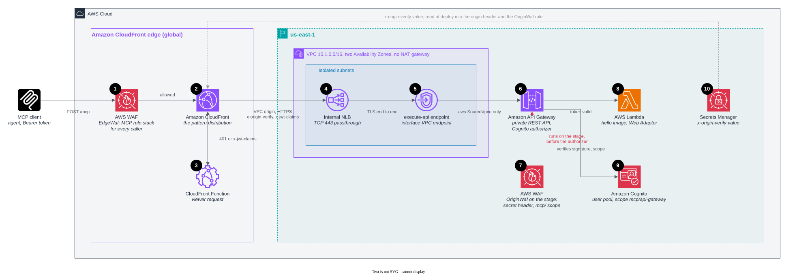

# Remote MCP servers behind Amazon CloudFront

This repository shows four ways to run a remote MCP (Model Context Protocol) server behind Amazon CloudFront and AWS
WAF. Each pattern is an AWS CDK app that you deploy on its own. Every pattern uses the same edge protection and the same
OAuth 2.0 authentication, so you can compare the origins directly.

## Why CloudFront and AWS WAF in front of an MCP server

A remote MCP server is a public HTTPS API that AI agents call. Three things set it apart from a typical API. Agents chain
calls, so the latency of each call adds up before the agent answers. A share of the traffic is protocol overhead with
fixed answers, such as OAuth challenges, discovery documents, and liveness checks. And part of the surface takes no
credentials, so the endpoint must stay safe for callers that it can't identify.

Putting CloudFront and AWS WAF in front of the server addresses each of these points.

- Agents finish sooner. TLS ends at the edge location nearest the caller, CloudFront reuses connections to the origin,
  and the edge answers protocol overhead without calling the origin.
- The endpoint stays open and bounded. AWS WAF rejects known-bad addresses, oversized bodies, unapproved tools,
  injection in tool arguments, and callers over a rate limit before the request reaches the Region. An MCP call names
  its method and tool in the JSON-RPC body, so you can write the limits in the protocol's terms: for each `initialize`,
  for each tool, and for each IP address.
- The origin handles only real work. The origin accepts traffic only from CloudFront, so every request that it sees has
  passed every edge check.
- You have one place to look. CloudFront and AWS WAF logs and metrics show what the edge absorbed, which rule blocked
  what, and what reached the origin.

## What is in this repository

The [`patterns/`](patterns/) directory holds four CDK apps. Each app deploys one CloudFront distribution that serves MCP
at `/mcp`, with AWS WAF and a CloudFront Function at the edge, in front of a different origin. Every app ends in the
same hello-world MCP server from the [`server/`](server/) directory, so the patterns differ only in the origin and in how
CloudFront locks that origin.

To deploy a pattern, install the dependencies once at the repository root, then run the CDK in the pattern's directory.
The AgentCore, API Gateway, and EKS apps build a container image, so they need Docker.

```bash
npm ci
cd patterns/pattern-mcp-eks-cloudfront
npx cdk bootstrap
npx cdk deploy
```

The stack outputs the MCP URL and what a client needs to get a token. For the commands, see
[Getting a token](#getting-a-token).

The following topics are common to all four patterns.

- Authentication. Every call needs an Amazon Cognito access token with the pattern's scope. A CloudFront Function
  decodes the token at the edge, and the origin verifies its signature. For details, see
  [Authentication](#authentication).
- AWS WAF at the edge. Every distribution carries the MCP rule stack from the AWS blog, with rate limits for each IP
  address, `initialize` call, and tool, plus Bot Control, a tool allowlist, and checks for SSRF, SQL injection, and XSS
  in tool arguments. For details, see [AWS WAF at the edge](#aws-waf-at-the-edge).
- Observability with AWS WAF. Every rule has its own metric and sampled requests, every tool call carries a label, and
  every block carries a request ID. For details, see [Observability with AWS WAF](#observability-with-aws-waf).
- The four patterns. The following sections describe Amazon Bedrock AgentCore, where a managed Gateway is the MCP
  endpoint that clients talk to, and Amazon API Gateway, Amazon EKS, and Lambda Web Function, where your own code is
  the MCP server. The
  [comparison table](#comparing-the-four-patterns) follows the patterns.

## The four patterns

### Amazon Bedrock AgentCore (managed MCP endpoint)

In this pattern, CloudFront sends requests to an AgentCore Gateway, and the Gateway calls an AgentCore Runtime that runs
the hello image. The following diagram shows the request path and the resources that the stack creates.


This is the managed path. You run nothing and you need no VPC. The Gateway endpoint is public, so a regional web ACL on
the Gateway admits only requests that carry CloudFront's secret header. The Gateway's own JWT authorizer verifies the
token and the `mcp/agentcore` scope before it calls any target. The Runtime accepts only the Gateway's role over SigV4.
CloudFront adds a custom domain and an edge web ACL to a managed endpoint that has neither. The first call after an
idle period sees a cold start, and tool names arrive as `hello___hello`. For details, see the
[Amazon Bedrock AgentCore pattern](patterns/pattern-mcp-agentcore-cloudfront/README.md).

### Amazon API Gateway (your own MCP server)

In this pattern, CloudFront uses a VPC origin to reach an internal Network Load Balancer. The load balancer passes the
request to an `execute-api` VPC endpoint, which reaches a private REST API. The API invokes an AWS Lambda function that
runs the hello image with Lambda Web Adapter. The following diagram shows the request path and the resources that the
stack creates.



This pattern makes a private API reachable from the internet without exposing it. The REST API has no public endpoint.
Its resource policy allows invocation only through the VPC endpoint. The load balancer's security group admits only
CloudFront's origin-facing addresses, and the API stage carries the regional web ACL. The load balancer passes TCP
through, so TLS runs from CloudFront to the endpoint without interruption. A Cognito authorizer on every method verifies
the token and the `mcp/api-gateway` scope, so Lambda never runs for a bad token. The load balancer and the interface
endpoint cost money while idle, and the REST API's 29-second timeout rules out long SSE streams. For details, see the
[Amazon API Gateway pattern](patterns/pattern-mcp-api-gateway-cloudfront/README.md).

### Amazon EKS (your own MCP server)

In this pattern, CloudFront uses a VPC origin to reach an internal Application Load Balancer, and the load balancer sends
requests to MCP server pods on an Amazon EKS Auto Mode cluster. The pods run in private subnets behind one NAT gateway.
The following diagram shows the request path and the resources that the stack creates.


This is the shape for teams that run containers on Kubernetes, and it has no public origin to protect. The load balancer
has only private IP addresses. Its security group admits only CloudFront's origin-facing addresses. It carries the
regional web ACL, so a workload inside the VPC can't skip the edge rules either. EKS Auto Mode provisions the nodes and
runs the load balancer controller, so the stack installs no add-ons. The stack creates the load balancer and its target
group, and a `TargetGroupBinding` registers the pod IP addresses. The pods verify the token and the `mcp/eks` scope
themselves. The cluster, its nodes, the load balancer, and the NAT gateway cost money while idle. For details, see the
[Amazon EKS pattern](patterns/pattern-mcp-eks-cloudfront/README.md).

### Lambda Web Function (your own MCP server)

In this pattern, CloudFront signs each origin request with origin access control and sends it to the regional endpoint of
a Lambda Web Function, which runs the hello server from a zip file. The following diagram shows the request path and the
resources that the stack creates.


This pattern has the strongest origin lock that you can get without a private network. The endpoint is public but
requires `IamAuth`. CloudFront signs every origin request with SigV4. The function's resource policy grants the
invoke permission only to this distribution, so Lambda refuses anything else before your code runs. Nothing in front of
the function checks tokens, so the hello server verifies the token and the `mcp/web-function` scope itself. You pay for
use only, with no VPC, load balancer, or NAT gateway. The function runs Node.js from a zip file only, and this pattern
has one web ACL layer rather than two. For details, see the
[Lambda Web Function pattern](patterns/pattern-mcp-web-function-cloudfront/README.md).

## Comparing the four patterns

The following table compares the patterns on the points that decide between them. For the full comparison, including
where the token is verified, cold starts, rate limiting, and what CloudFront adds to each origin, see
[Comparing the patterns](docs/comparison.md).

| Pattern | The MCP server | Origin lock | Idle cost |
|---|---|---|---|
| AgentCore | AgentCore Gateway, a managed MCP endpoint, with your container behind it | Secret header, checked by a regional web ACL | None |
| API Gateway | Your code, on Lambda | Private API, reached only through a VPC origin and a VPC endpoint | NLB and VPC endpoint |
| EKS | Your code, in pods on EKS Auto Mode | Internal ALB, reached only through a VPC origin | Cluster, nodes, ALB, NAT gateway |
| Lambda Web Function | Your code, on a Lambda Web Function | IAM: CloudFront signs each request with SigV4 | None |

## Further details

### Authentication

Every pattern requires an OAuth 2.0 access token from Amazon Cognito in the `Authorization: Bearer` header. Each
pattern has its own user pool, defined in [lib/auth.ts](lib/auth.ts), that issues tokens with the client credentials
grant and one scope: `mcp/agentcore`, `mcp/api-gateway`, `mcp/eks`, or `mcp/web-function`. The scope stands in for an
audience, because Cognito binds `aud` to a resource (RFC 8707) only for user sign-in, not for client credentials.

The following diagram shows the authorization flow, numbered as in the steps that follow it.


1. The client sends its first call without a token. AWS WAF runs its rules, then the viewer-request CloudFront Function
   in [lib/viewer-request.js](lib/viewer-request.js) answers `401` with
   `WWW-Authenticate: Bearer resource_metadata="https://<distribution>/.well-known/oauth-protected-resource/mcp"`. The
   origin is not called.
2. The client fetches that [RFC 9728](https://www.rfc-editor.org/rfc/rfc9728) document. The origin serves it and
   CloudFront caches it. On AgentCore the function serves it, because the Gateway's own document names the Gateway's
   hostname. The document names the distribution's `/mcp` as the resource and the user pool as the authorization server.
3. The client reads the user pool's `/.well-known/openid-configuration` document to find the token endpoint.
4. The client requests a client-credentials token with the pattern's scope and receives an RS256 access token.
5. The client repeats the call with the token. The function decodes the token and refuses it at the edge if it is
   malformed, expired, from another issuer, or not an access token. Otherwise, the function forwards the request with
   the claims in the `x-jwt-claims` header and the viewer host in the `x-forwarded-host` header. The function doesn't
   check the signature, because CloudFront Functions offer HMAC but no RSA verification.
6. The origin fetches the user pool's keys (JWKS), verifies the signature and the scope, and answers. A token that was
   edited after signing passes the edge and fails here.

Each origin checks the signature with its own verifier.

- AgentCore uses the Gateway's custom JWT authorizer, configured with the pool's discovery URL, the client, and the
  scope.
- API Gateway uses a Cognito authorizer on every method, so Lambda never runs for a bad token.
- EKS uses the hello server, in [server/auth.js](server/auth.js). ALB JWT verification needs an HTTPS listener and a
  certificate for your own domain. If you have one, you can move the check to the load balancer.
- Lambda Web Function uses the hello server, because nothing in front of the function checks tokens.

### AWS WAF at the edge

Each distribution carries a CloudFront-scope web ACL named `EdgeWaf`, defined in [lib/waf.ts](lib/waf.ts). The web ACL
runs the rule stack from the blog post
[Protect MCP endpoints at the edge with Amazon CloudFront and AWS WAF](https://aws.amazon.com/blogs/networking-and-content-delivery/protect-mcp-endpoints-at-the-edge-with-amazon-cloudfront-and-aws-waf/),
plus the Amazon IP reputation list and a rate limit on `initialize`. It runs before the CloudFront Function and before
any origin, so a blocked request costs nothing downstream. The rules read the method and the tool from the JSON-RPC body
(`/method` and `/params/name`), because current MCP SDK clients don't send `mcp-method` or `mcp-name` headers.

The following table lists the rules in the order that they run.

| Priority | Rule | What it does |
|---|---|---|
| 10 | `AmazonIpReputation` | Blocks addresses on Amazon's threat intelligence lists |
| 20 | `RateLimitPerIp` | Allows 1,000 requests to `/mcp` for each IP address in 5 minutes |
| 30 | `RateLimitInitializePerIp` | Allows 100 `initialize` calls for each IP address in 5 minutes, because a session open costs the origin more than a tool call |
| 50 | `BotControlCommon` | Runs AWS WAF Bot Control, which labels each caller with its bot category, Web Bot Auth result, cloud provider, and HTTP library. The five sub-rules that block ordinary agent traffic are set to Count |
| 60 | `MCPBodySizePreflight` | Blocks bodies over 32 KB, so the later body rules can use `OversizeHandling: NO_MATCH` |
| 70 | `BlockJsonRpcBatch` | Blocks JSON-RPC batches, so a `tools/call` can't hide in an array |
| 80 | `RequireMCPProtocolVersion` | Requires `mcp-protocol-version` to be `2025-06-18` or `2025-11-25`. The `initialize` call is exempt |
| 90 | `BlockUnapprovedMCPTools` | Allows `tools/call` only for `hello`, or `hello___hello` as AgentCore Gateway names it. Unparseable JSON counts as unapproved |
| 100–102 | `LabelTool*` | Count rules that stamp `mcp:tool:<name>` on a `tools/call`, one rule for each tool, for the rules that follow |
| 110 | `BlockUnverifiedBotOnHighCostTool` | Matches a labeled tool called by a caller whose Web Bot Auth signature is `invalid` or `unknown_bot`. Ships in Count so that you can watch it before you switch it to Block |
| 120 | `BlockDestructiveSQL` | Blocks `DROP`, `TRUNCATE`, `ALTER`, `DELETE FROM`, and similar keywords in the `query` argument of `query_database` |
| 121 | `BlockMCPSSRF` | Blocks tool arguments that name the IMDS endpoint, cloud metadata hosts, `kubernetes.default`, `.local` or `.internal` names, or loopback, link-local, and private IP ranges |
| 122 | `MCPSQLiProtection` | Runs every string under `params.arguments` through the SQL injection parser at sensitivity `LOW`. The `execute_sql` tool is exempt by label |
| 123 | `MCPXSSProtection` | Runs the same values through the XSS parser |
| 160 | `RateLimitPerTool` | Allows 200 requests in 5 minutes for each labeled tool and IP address |

Blocked requests receive a JSON-RPC error with HTTP status 403. The `query_database` and `execute_sql` rules guard tools
that the hello server doesn't have. They show you the shape to copy for your own tools. Bot Control is billed on top of
the web ACL, as described in [AWS WAF pricing](https://aws.amazon.com/waf/pricing/). To deploy without it, run
`npx cdk deploy -c botControl=false`. The SSRF rule is one layer of defense. Lock the tool executor's egress as well.

Where the origin can take a web ACL, which is the case for the AgentCore Gateway, the API Gateway stage, and the ALB, the
stack adds a regional web ACL named `OriginWaf`. It blocks by default and allows only requests that carry CloudFront's
secret `x-origin-verify` header and an `mcp/` scope in the `x-jwt-claims` header that the CloudFront Function sets.
A network lock proves that a request came from CloudFront. This web ACL is what reads the secret header, so the origin
can tell a request that came through this distribution, with its edge rules, from one that came through another
distribution in the same account. On AgentCore it is the only origin lock available. On API Gateway and EKS the network
already locks the origin, so the layer is optional there. Each of those patterns has a note on what it adds and what it
costs.

### Observability with AWS WAF

The two web ACLs give you several ways to see what the edge is doing.

- Every rule in both web ACLs publishes its own CloudWatch metrics (`AllowedRequests`, `BlockedRequests`, and
  `CountedRequests` under the rule's name) and keeps sampled requests. The AWS WAF console shows which rule fired, how many times
  it fired, and the sampled requests from the past three hours with their headers and labels.
- The `LabelTool*` rules stamp `mcp:tool:<name>` on each `tools/call`, and Bot Control adds
  `awswaf:managed:aws:bot-control:*` labels for the bot category and the Web Bot Auth result. Labels appear in the
  sampled requests and in the logs, so you can see which callers use which tools before you tighten a rule.
- The edge web ACL answers each block with an `x-mcp-waf-request-id` header that carries the AWS WAF request ID, so you
  can match a client's error report to the log record that explains it.
- This sample doesn't turn on AWS WAF logging. To get a record for each request with the terminating rule, every
  label, and the rule actions along the way, create a CloudWatch Logs log group whose name starts with `aws-waf-logs-`
  in us-east-1, then run `aws wafv2 put-logging-configuration` with the web ACL's ARN. The CloudWatch Logs Insights
  queries in the blog post, such as top tools, tool enumeration spikes for each IP address, and verified-agent and tool
  baselines, work on those logs, as do the AI traffic dashboards in the AWS WAF console.
- Deploy a new rule in Count, read its metric and sampled requests for a soak window, and then switch it to Block. The
  `BlockUnverifiedBotOnHighCostTool` rule ships in Count for that reason.

### Caching

The `/mcp` path uses the `CachingDisabled` policy, because every MCP call is a `POST` that differs from the last. The
`/.well-known/*` path uses the `CachingOptimized` policy, so the edge answers discovery after a `401` without calling
the origin. The MCP path still gains TLS termination near the caller and warm connections to the origin.

### Getting a token

Every stack outputs `McpUrl` (`https://<distribution>.cloudfront.net/mcp`), `Scope`, `TokenUrl`, `UserPoolId`, and
`ClientId`. The following commands get a token and call the tool. On AgentCore, use `hello___hello` as the tool name.

```bash
stack=PatternMcpEksCloudFront
out() { aws cloudformation describe-stacks --stack-name "$stack" --query "Stacks[0].Outputs[?OutputKey=='$1'].OutputValue" --output text; }
secret=$(aws cognito-idp describe-user-pool-client --user-pool-id "$(out UserPoolId)" --client-id "$(out ClientId)" \
  --query UserPoolClient.ClientSecret --output text)
token=$(curl -s -u "$(out ClientId):$secret" -d grant_type=client_credentials -d "scope=$(out Scope)" "$(out TokenUrl)" \
  | sed -n 's/.*"access_token":"\([^"]*\)".*/\1/p')
curl -X POST "$(out McpUrl)" -H "authorization: Bearer $token" -H 'content-type: application/json' \
  -H 'accept: application/json, text/event-stream' -H 'mcp-protocol-version: 2025-11-25' \
  -d '{"jsonrpc":"2.0","id":1,"method":"tools/call","params":{"name":"hello","arguments":{"name":"edge"}}}'
```

To see the edge web ACL at work, send `' OR 1=1 --` or `http://169.254.169.254/` as the `name` argument. The edge
answers a JSON-RPC 403 before the origin sees the call. To remove a pattern, run `npx cdk destroy` in its directory.
The `npm test` command runs the unit tests for the web ACLs, the CloudFront Function, and the server, and
`npm run synth` synthesizes all four apps.

## Further reading

- [How Amazon CloudFront secures and accelerates the AWS MCP Server](https://aws.amazon.com/blogs/networking-and-content-delivery/how-amazon-cloudfront-secures-and-accelerates-the-aws-mcp-server/)
- [Protect MCP endpoints at the edge with Amazon CloudFront and AWS WAF](https://aws.amazon.com/blogs/networking-and-content-delivery/protect-mcp-endpoints-at-the-edge-with-amazon-cloudfront-and-aws-waf/)

## Contributors

Thanks to the people behind this project.

- Harith Gaddamanugu, Sr. Edge Solutions Architect
- Sandeep Panda, Sr. Product Manager, Tech ES
- Eitav Arditti, Sr. Edge Solutions Architect

## Security

See [CONTRIBUTING](CONTRIBUTING.md#security-issue-notifications) for more information.

## License

This library is licensed under the MIT-0 License. See the LICENSE file.
