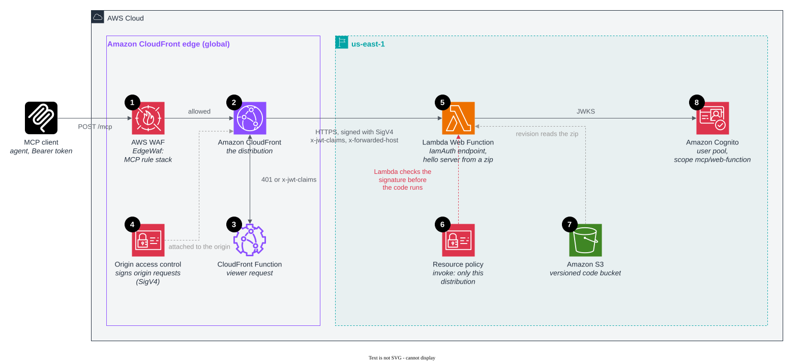
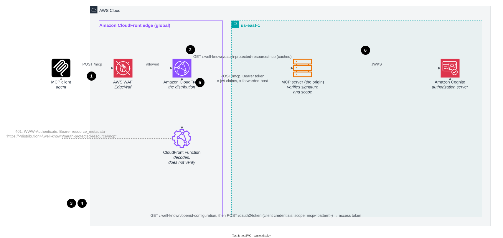

# Remote MCP servers behind Amazon CloudFront

Four architecture patterns for putting a remote MCP (Model Context Protocol) server behind Amazon CloudFront and AWS
WAF, with OAuth 2.0 authentication, one AWS CDK app each.

## Why CloudFront and AWS WAF in front of an MCP server

A remote MCP server is a public HTTPS API called by agents. Agents chain calls, so latency on each one adds up. A share
of the traffic is protocol overhead with fixed answers (OAuth challenges, discovery, liveness). And part of the surface
takes no credentials, so the endpoint must stay safe for callers it cannot identify.

- **Agents finish sooner.** TLS ends at the edge location nearest the caller, connections to the origin are reused, and
  protocol overhead is answered at the edge.
- **The endpoint stays open and bounded.** AWS WAF rejects known-bad addresses, oversized bodies, unapproved tools,
  injection in tool arguments and callers over a rate limit before the Region. Because an MCP call names its method and
  tool in the JSON-RPC body, the limits are written in the protocol's terms: per `initialize`, per tool, per IP.
- **The origin handles only real work.** The origin accepts traffic only from CloudFront, so a request it sees carries
  proof that it passed every edge check.
- **One place to look.** CloudFront and AWS WAF logs and metrics show what the edge absorbed, which rule blocked what,
  and what reached the origin.

## What is in this repository

Four CDK apps under [`patterns/`](patterns/). Each deploys one CloudFront distribution serving MCP at `/mcp`, with the
same edge protection and the same token flow, in front of a different origin. Every app ends in the same hello-world MCP
server ([`server/`](server/)), so the patterns differ only in the origin and in how it is locked to CloudFront.

```bash
npm ci                                      # once, at the repository root
cd patterns/pattern-mcp-eks-cloudfront      # or any other pattern directory
npx cdk bootstrap                           # once per account, in us-east-1
npx cdk deploy
```

The stack outputs the MCP URL and what a client needs for a token. [Getting a token](#getting-a-token) shows the
calls. Docker is needed for the apps that build a container image (all but Web Function).

- **Authentication.** Every call needs an Amazon Cognito access token with the pattern's scope. A CloudFront Function
  decodes it at the edge and answers `401`. The origin verifies the signature. [Details](#authentication).
- **AWS WAF at the edge.** The MCP rule stack from the AWS blog on every distribution: rate limits per IP, `initialize`
  and tool, Bot Control, tool allowlist, SSRF, SQLi and XSS in tool arguments. [Details](#aws-waf-at-the-edge).
- **Observability with AWS WAF.** A metric per rule, sampled requests, labels on every tool call and a request ID in
  every block. [Details](#observability-with-aws-waf).
- **Four patterns.** AgentCore, API Gateway, EKS and Lambda Web Function, below, and side by side in
  [docs/comparison.md](docs/comparison.md).

## The four patterns

### Amazon Bedrock AgentCore

CloudFront → AgentCore Gateway → AgentCore Runtime running the hello image.


The managed path: nothing to run and no VPC. The Gateway endpoint is public, so a regional web ACL on it admits only
requests carrying CloudFront's secret header. The Gateway's own JWT authorizer verifies the token and the
`mcp/agentcore` scope before any target is called, and the Runtime accepts only the Gateway's role over SigV4.
CloudFront adds a custom domain and edge WAF to a managed endpoint that has neither. The first call after idle sees a
cold start, and tool names arrive as `hello___hello`.
[patterns/pattern-mcp-agentcore-cloudfront](patterns/pattern-mcp-agentcore-cloudfront/README.md)

### Amazon API Gateway

CloudFront → VPC origin → internal Network Load Balancer → `execute-api` VPC endpoint → private REST API → AWS Lambda
running the hello image with Lambda Web Adapter.


A private API made reachable from the internet without exposing it. The REST API has no public endpoint: its resource
policy allows invocation only through the VPC endpoint, the NLB's security group admits only CloudFront's origin-facing
addresses, and the stage carries the regional web ACL. The NLB passes TCP through, so TLS runs end to end from
CloudFront to the endpoint. A Cognito authorizer on every method verifies the token and the `mcp/api-gateway` scope, so
Lambda never runs for a bad token. Fixed cost for the NLB and the interface endpoint, and the REST API's 29-second
timeout rules out long SSE streams.
[patterns/pattern-mcp-api-gateway-cloudfront](patterns/pattern-mcp-api-gateway-cloudfront/README.md)

### Amazon EKS

CloudFront → VPC origin → internal Application Load Balancer → MCP server pods on an Amazon EKS Auto Mode cluster, in
private subnets behind one NAT gateway.


The container-platform shape, with no public origin to protect. The ALB has only private IPs, its security group admits
only CloudFront's origin-facing addresses, and it carries the regional web ACL, so a workload inside the VPC cannot skip
the edge rules either. EKS Auto Mode provisions the nodes and runs the load balancer controller, so the stack installs no
add-ons: it creates the ALB and target group, and a `TargetGroupBinding` registers the pod IPs. The pods verify the
token and the `mcp/eks` scope themselves. Costs while idle: the cluster, its nodes, the ALB and the NAT gateway.
[patterns/pattern-mcp-eks-cloudfront](patterns/pattern-mcp-eks-cloudfront/README.md)

### Lambda Web Function

CloudFront, signing with origin access control → regional endpoint of a Lambda Web Function → the hello server from a
zip.



The strongest lock without a private network. The endpoint is public but takes `IamAuth`: CloudFront signs every origin
request with SigV4, and the function's resource policy grants the invoke permission only for this distribution, so
Lambda refuses anything else before your code runs. Nothing in front of the function checks tokens, so the hello server
verifies the token and the `mcp/web-function` scope itself. Pay per use with no VPC, load balancer or NAT. Node.js from
a zip only, and one web ACL layer rather than two.
[patterns/pattern-mcp-web-function-cloudfront](patterns/pattern-mcp-web-function-cloudfront/README.md)

## Further details

### Authentication

Every pattern requires an OAuth 2.0 access token from Amazon Cognito in `Authorization: Bearer`, issued by that
pattern's own user pool ([lib/auth.ts](lib/auth.ts)) with the client credentials grant and one scope
(`mcp/agentcore`, `mcp/api-gateway`, `mcp/eks` or `mcp/web-function`). The scope stands in for an audience: Cognito
binds `aud` to a resource (RFC 8707) only for user sign-in, not for client credentials.



1. **First call, no token.** AWS WAF runs, then the viewer-request CloudFront Function
   ([lib/viewer-request.js](lib/viewer-request.js)) answers `401` with
   `WWW-Authenticate: Bearer resource_metadata="https://<distribution>/.well-known/oauth-protected-resource/mcp"`. The
   origin is not called.
2. **Discovery.** The client fetches that [RFC 9728](https://www.rfc-editor.org/rfc/rfc9728) document. The origin
   serves it (on AgentCore the function does, because the Gateway's own names the Gateway's hostname) and CloudFront
   caches it. It names the distribution's `/mcp` as `resource` and the user pool as authorization server.
3. **Issuer metadata.** The client reads the user pool's `/.well-known/openid-configuration`.
4. **Token.** The client requests a client-credentials token with the pattern's scope and gets an RS256 access token.
5. **Authorized call.** The function decodes the token and refuses it at the edge if it is malformed, expired, from
   another issuer or not an access token. Otherwise it forwards the request with the claims in `x-jwt-claims` and the
   viewer host in `x-forwarded-host`. It does not check the signature: CloudFront Functions have HMAC but no RSA verify.
6. **Verified at the origin.** The origin fetches the user pool's keys (JWKS), verifies the signature and the scope,
   and answers. A token edited after signing passes the edge and fails here.

| Pattern | Signature checked by |
|---|---|
| AgentCore | The Gateway's custom JWT authorizer, with the pool's discovery URL, the client and the scope |
| API Gateway | A Cognito authorizer on every method. Lambda never runs for a bad token |
| EKS | The hello server ([server/auth.js](server/auth.js)). ALB JWT verification needs an HTTPS listener and a certificate for your own domain. With one, move the check there |
| Web Function | The hello server. Nothing in front of the function checks tokens |

### AWS WAF at the edge

Each distribution carries a CloudFront-scope web ACL, `EdgeWaf` ([lib/waf.ts](lib/waf.ts)), with the rule stack from
[Protect MCP endpoints at the edge with Amazon CloudFront and AWS WAF](https://aws.amazon.com/blogs/networking-and-content-delivery/protect-mcp-endpoints-at-the-edge-with-amazon-cloudfront-and-aws-waf/)
plus the Amazon IP reputation list and a rate limit on `initialize`. It runs before the CloudFront Function and before
any origin, so a blocked request costs nothing downstream. The method and tool are read from the JSON-RPC body
(`/method`, `/params/name`), because current MCP SDK clients send no `mcp-method` or `mcp-name` header.

| Priority | Rule | What it does |
|---|---|---|
| 10 | `AmazonIpReputation` | Blocks addresses on Amazon's threat intelligence lists |
| 20 | `RateLimitPerIp` | 1,000 requests per 5 minutes per IP on `/mcp` |
| 30 | `RateLimitInitializePerIp` | 100 `initialize` calls per 5 minutes per IP: a session open costs the origin more than a tool call |
| 50 | `BotControlCommon` | AWS WAF Bot Control labels each caller (verified bot, Web Bot Auth result, cloud provider, HTTP library). The five sub-rules that would block ordinary agent traffic are set to Count |
| 60 | `MCPBodySizePreflight` | Blocks bodies over 32 KB, so every later body rule can use `OversizeHandling: NO_MATCH` |
| 70 | `BlockJsonRpcBatch` | Blocks JSON-RPC batches, so a `tools/call` cannot hide in an array |
| 80 | `RequireMCPProtocolVersion` | `mcp-protocol-version` must be `2025-06-18` or `2025-11-25`. `initialize` is exempt |
| 90 | `BlockUnapprovedMCPTools` | `tools/call` only for `hello` (or `hello___hello`, as AgentCore Gateway names it). Unparseable JSON counts as unapproved |
| 100–102 | `LabelTool*` | Count rules that stamp `mcp:tool:<name>` on a `tools/call`, one per tool, for the rules below |
| 110 | `BlockUnverifiedBotOnHighCostTool` | A labeled tool called by a caller whose Web Bot Auth signature is `invalid` or `unknown_bot`. Ships in Count: soak it, then switch to Block |
| 120 | `BlockDestructiveSQL` | `DROP`, `TRUNCATE`, `ALTER`, `DELETE FROM` and the like in `query_database`'s `query` argument |
| 121 | `BlockMCPSSRF` | Tool arguments naming the IMDS endpoint, cloud metadata hosts, `kubernetes.default`, `.local`/`.internal` names, or loopback, link-local and private IP ranges |
| 122 | `MCPSQLiProtection` | Every string under `params.arguments` through the SQL injection parser at sensitivity `LOW` (`execute_sql` exempt by label) |
| 123 | `MCPXSSProtection` | The same values through the XSS parser |
| 160 | `RateLimitPerTool` | 200 requests per 5 minutes per labeled tool and IP |

Blocked requests get a JSON-RPC error with HTTP 403. The `query_database` and `execute_sql` rules guard tools the hello
server does not have. They show the shape to copy. Bot Control is billed on top of the web ACL
([pricing](https://aws.amazon.com/waf/pricing/)). `npx cdk deploy -c botControl=false` leaves it out. The SSRF rule is
defense in depth: lock the tool executor's egress as well.

Where the origin can take a web ACL (AgentCore Gateway, API Gateway stage, ALB) a regional one, `OriginWaf`, defaults to
block and allows only requests carrying CloudFront's secret `x-origin-verify` header and an `mcp/` scope in the
`x-jwt-claims` header the CloudFront Function sets. Network locks prove a request came from CloudFront. This proves it
came through *this* distribution and its edge rules, and keeps a workload inside the VPC from skipping them.

### Observability with AWS WAF

- **A metric per rule.** Every rule in both web ACLs publishes its own CloudWatch metric (`AllowedRequests`,
  `BlockedRequests`, `CountedRequests` under the rule's name) and keeps sampled requests, so the AWS WAF console shows
  which rule fired, how often, and the last three hours of sampled requests with their headers and labels.
- **Labels on every tool call.** The `LabelTool*` rules stamp `mcp:tool:<name>` on each `tools/call`, and Bot Control
  adds `awswaf:managed:aws:bot-control:*` labels (bot category, Web Bot Auth result). Labels appear in the sampled
  requests and in the logs, so you can see which tools which kinds of callers use before you tighten a rule.
- **A request ID in every block.** The edge web ACL answers blocks with an `x-mcp-waf-request-id` header carrying the
  AWS WAF request ID, so a client's error report can be matched to the log record that explains it.
- **Logs.** This sample does not enable AWS WAF logging. Turn it on for a per-request record with the terminating
  rule, every label and the rule actions along the way: create a CloudWatch Logs log group whose name starts with
  `aws-waf-logs-` in us-east-1 and run `aws wafv2 put-logging-configuration` with the web ACL's ARN. The CloudWatch
  Logs Insights queries in the blog (top tools, tool-enumeration spikes per IP, verified-agent and tool baselines) and
  the AI traffic dashboards in the AWS WAF console work on those logs.
- **Count first.** Deploy a new rule in Count, read its metric and sampled requests for a soak window, then switch it to
  Block. `BlockUnverifiedBotOnHighCostTool` ships in Count for that reason.

### Caching

`/mcp` uses `CachingDisabled`: every MCP call is a `POST` that differs per request. `/.well-known/*` uses
`CachingOptimized`, so discovery after a `401` is answered at the edge. The MCP path still gains TLS termination near
the caller and warm connections to the origin.

### Getting a token

Every stack outputs `McpUrl` (`https://<distribution>.cloudfront.net/mcp`), `Scope`, `TokenUrl`, `UserPoolId` and
`ClientId`. Get a token and call the tool (on AgentCore the tool is `hello___hello`):

```bash
stack=PatternMcpEksCloudFront
out() { aws cloudformation describe-stacks --stack-name "$stack" --query "Stacks[0].Outputs[?OutputKey=='$1'].OutputValue" --output text; }
secret=$(aws cognito-idp describe-user-pool-client --user-pool-id "$(out UserPoolId)" --client-id "$(out ClientId)" \
  --query UserPoolClient.ClientSecret --output text)
token=$(curl -s -u "$(out ClientId):$secret" -d grant_type=client_credentials -d "scope=$(out Scope)" "$(out TokenUrl)" \
  | sed -n 's/.*"access_token":"\([^"]*\)".*/\1/p')
curl -X POST "$(out McpUrl)" -H "authorization: Bearer $token" -H 'content-type: application/json' \
  -H 'accept: application/json, text/event-stream' -H 'mcp-protocol-version: 2025-11-25' \
  -d '{"jsonrpc":"2.0","id":1,"method":"tools/call","params":{"name":"hello","arguments":{"name":"edge"}}}'
```

Send `' OR 1=1 --` or `http://169.254.169.254/` as the `name` argument instead and the edge web ACL answers a JSON-RPC
403 before the origin sees the call. `npx cdk destroy` removes a pattern. `npm test` runs the unit tests for the web
ACLs, the CloudFront Function and the server. `npm run synth` synthesizes all four apps.

## Further reading

- [How Amazon CloudFront secures and accelerates the AWS MCP Server](https://aws.amazon.com/blogs/networking-and-content-delivery/how-amazon-cloudfront-secures-and-accelerates-the-aws-mcp-server/)
- [Protect MCP endpoints at the edge with Amazon CloudFront and AWS WAF](https://aws.amazon.com/blogs/networking-and-content-delivery/protect-mcp-endpoints-at-the-edge-with-amazon-cloudfront-and-aws-waf/)

## Contributors

Thanks to the people behind this project:

- Harith Gaddamanugu, Sr. Edge Solutions Architect
- Sandeep Panda, Sr. Product Manager, Tech ES
- Eitav Arditti, Sr. Edge Solutions Architect

## Security

See [CONTRIBUTING](CONTRIBUTING.md#security-issue-notifications) for more information.

## License

This library is licensed under the MIT-0 License. See the LICENSE file.
