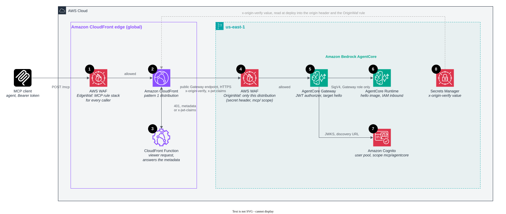

# Pattern 1: Amazon Bedrock AgentCore

Its own CloudFront distribution (`/mcp`, stack output `AgentCoreMcp`) → Amazon Bedrock AgentCore Gateway → AgentCore
Runtime running the hello image.

The managed path: nothing to run and no VPC. The Gateway is a public endpoint, so a regional AWS WAF web ACL on it
accepts only requests carrying CloudFront's secret header. The Gateway's own JWT authorizer verifies the token before
any target is called, and the Runtime accepts only the Gateway's role. The first call after idle sees a cold start, and
tool names arrive as `<target>___<tool>`.

## Deployed resource details



1. **AWS WAF at the edge** inspects the `POST /mcp` before anything else runs: IP reputation, rate limits, body size,
   protocol version, tool allowlist (which accepts `hello___hello`, the Gateway's name for the tool), and SSRF, SQL and
   XSS in tool arguments.
2. **The CloudFront distribution** receives what the web ACL allowed and forwards to the Gateway's public hostname with
   the secret `x-origin-verify` header added. `/mcp` is not cached.
3. **The CloudFront Function** decodes the Bearer token and answers `401` at the edge for a missing, malformed, expired
   or foreign token. It also answers the protected-resource metadata itself, because the Gateway's own document names
   the Gateway's hostname rather than the distribution's.
4. **AWS WAF on the Gateway** admits only requests with the secret header and an `mcp/` scope in `x-jwt-claims`, so a
   call straight to the public Gateway endpoint is refused before the Gateway does any work.
5. **The AgentCore Gateway** verifies the token's signature and the `mcp/agentcore` scope with its Cognito JWT
   authorizer, then calls its one target, `hello`.
6. **The AgentCore Runtime** runs the hello image and serves the MCP protocol. Its inbound authorizer is IAM: only the
   Gateway's role, signing with SigV4, can invoke it.
7. **Amazon Cognito** issues the tokens and publishes the discovery document and keys the Gateway (5) verifies against.
8. **Secrets Manager** holds the random `x-origin-verify` value. At deploy the stack reads it into the distribution's
   origin header (2) and the regional web ACL's rule (4).

### The edge

Global. Every request enters the edge location nearest the client, where TLS ends and where 1 to 3 run, in that order,
before the Region sees anything.

#### 1. AWS WAF web ACL `EdgeWaf`

- CloudFront scope, shared by every pattern distribution in the stack ([lib/waf.ts](../../lib/waf.ts)). The MCP rule
  stack is documented once, in the [root README](../../README.md#aws-waf-at-the-edge).
- The tool allowlist accepts `hello` and `hello___hello`: the Gateway prefixes every tool with its target name.
- The Gateway accepts MCP protocol versions `2025-06-18` and `2025-11-25`, the ones the edge web ACL lets through. Its
  default is `2025-03-26` only, which the edge would reject.

#### 2. Amazon CloudFront distribution

- Origin: the Gateway's own hostname, `<gateway-id>.gateway.bedrock-agentcore.<region>.amazonaws.com`, over HTTPS. The
  default behavior forwards the path as is, so the Gateway receives `/mcp`.
- `ALL_VIEWER_EXCEPT_HOST_HEADER` forwards the viewer's `Authorization` header to the Gateway's authorizer (5).
- Adds the secret `x-origin-verify` header (8) to every origin request.
- What CloudFront adds here: a custom domain and the edge web ACL in front of a managed endpoint that has neither, TLS
  termination and connection reuse from edge locations close to the client, and one front door for a Gateway that
  serves one Region.

#### 3. CloudFront Function (viewer request)

- [lib/viewer-request.js](../../lib/viewer-request.js) with `METADATA_SCOPE` set to `mcp/agentcore`. Decodes the token
  and answers `401` with `WWW-Authenticate: Bearer resource_metadata=...` without calling the Gateway. Sets
  `x-jwt-claims` for the regional web ACL (4).
- Answers `GET /.well-known/oauth-protected-resource/mcp` at the edge (`x-cache: FunctionGeneratedResponse`), with
  `resource` set to `https://<distribution>/mcp`, the Cognito issuer and the scope. The Gateway publishes its own
  document, but with its own hostname as `resource`, and an MCP client must refuse a document whose `resource` differs
  from the URL it called. The Gateway never sees discovery traffic.

### The Region (us-east-1)

#### 4. AWS WAF web ACL `OriginWaf`

- Regional, associated with the Gateway, shared with the REST API stage (pattern 2) and the ALB (pattern 5). Default
  block. Allows only requests with the exact `x-origin-verify` value and an `mcp/` scope in `x-jwt-claims`.
- This is the origin lock. The Gateway endpoint is public and takes no security group or resource policy that can
  name CloudFront, so the shared secret checked here is what keeps direct callers out. A call straight to the Gateway
  gets HTTP 403 with the JSON-RPC error `-32002` (`Forbidden - Request blocked by AWS WAF`) and never reaches the
  Runtime. The Gateway's WAF failure mode is left at its default, `FAIL_CLOSE`.
- A stricter, private lock is possible but not built: the Gateway has an AWS PrivateLink interface endpoint, and a
  Gateway resource-based policy can deny requests whose `aws:SourceVpce` is not that endpoint. CloudFront cannot use
  that endpoint directly (VPC origins reach only an ALB, an NLB or an EC2 instance), so it would need a load balancer in
  front of the endpoint's network interfaces and a TLS setup where the name CloudFront checks matches the certificate the
  origin presents.

#### 5. AgentCore Gateway

- One MCP server target, `hello`, whose endpoint is the Runtime's invocation URL. The Gateway signs calls to the
  Runtime with its own service role (outbound IAM auth, service `bedrock-agentcore`).
- Inbound authorizer `GatewayAuthorizer.usingCognito`: checks each access token's signature against the user pool's
  discovery URL and allows only the stack's app client and the scope `mcp/agentcore`. See
  [Authentication](../../README.md#authentication).
- Rate limiting: the edge rate rules, plus any rate rule you add to the regional web ACL (4).

#### 6. AgentCore Runtime

- Runs the shared arm64 hello image with the MCP protocol. The Runtime serves the container's `POST :8000/mcp`.
- Inbound authorizer IAM: only SigV4-signed callers with `bedrock-agentcore:InvokeAgentRuntime` can reach it, and the
  Gateway's role is the only principal allowed. The Runtime has no lock of its own to CloudFront because CloudFront never
  calls it.
- Starts a session on demand, so the first call after idle sees a cold start.

#### 7. Amazon Cognito user pool

- The one issuer for the stack ([lib/auth.ts](../../lib/auth.ts)). This pattern's scope is `mcp/agentcore`. The stack
  outputs `TokenUrl`, `UserPoolId` and `ClientId`. The [root README](../../README.md#deploy) shows how to get a token.

#### 8. AWS Secrets Manager secret

- A 32-character random value generated at deploy, read into the origin header (2) and the `OriginWaf` rule (4). Rotate
  it by updating the secret and redeploying.

## Deploy with CloudFormation

Push the hello image first ([Deploy with CloudFormation](../../README.md#deploy-with-cloudformation) in the root
README has the commands), then deploy [`cfn/agentcore.yaml`](../../cfn/agentcore.yaml) from the repository root:

```bash
aws cloudformation deploy --region us-east-1 --template-file cfn/agentcore.yaml --stack-name cloudfront-mcp-agentcore \
  --parameter-overrides ImageRepository=cloudfront-mcp-hello --capabilities CAPABILITY_IAM --tags auto-delete=no
```

The stack outputs `AgentCoreMcp` and, for a token with scope `mcp/agentcore`, `TokenUrl`, `UserPoolId` and `ClientId`.
The Runtime (`<stack name>_hello`, hyphens turned into underscores), the Gateway and the CloudFront Function take their
names from the stack name, so the template deploys beside the CDK stack or another copy in the same account. Keep the
stack name to 40 characters: the Function name holds at most 64 and the Runtime name 48.

## Trade-offs

- The least to run: no VPC, no load balancer, no idle compute. The Runtime starts a session on demand, so the first
  call after idle sees a cold start.
- Tool names change: clients see `<target>___<tool>`. One Gateway can aggregate many targets (MCP servers, Lambda
  functions, OpenAPI or Smithy APIs) behind one MCP endpoint.
- The lock rests on a shared secret checked by WAF, not on the network. Rotate it by updating the secret and redeploying.
