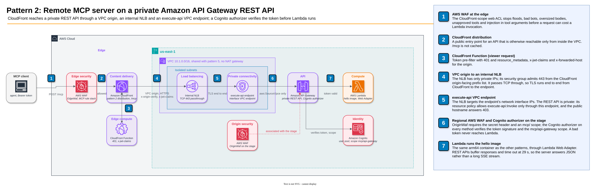

# Pattern 2: Amazon API Gateway

Its own CloudFront distribution (`/mcp`) → CloudFront VPC origin → internal Network Load Balancer → `execute-api` VPC endpoint → private
API Gateway REST API → AWS Lambda running the hello image with Lambda Web Adapter.



## How the origin is locked down

- The REST API is private: it has no public endpoint, and its resource policy allows `execute-api:Invoke` only through
  this VPC endpoint (`aws:SourceVpce`). A call to the public `execute-api` hostname gets `403 Forbidden`.
- CloudFront reaches the API through a [VPC origin](https://docs.aws.amazon.com/AmazonCloudFront/latest/DeveloperGuide/private-content-vpc-origins.html)
  on an internal NLB. The NLB passes TCP 443 straight through to the VPC endpoint's network interface IPs, so TLS runs
  end to end between CloudFront and the endpoint. The origin domain is the API's own hostname,
  `<api-id>.execute-api.<region>.amazonaws.com`: CloudFront validates the endpoint's `*.execute-api` certificate
  against it, and the Host header routes the request to this API. The
  hostname has no public DNS; CloudFront reaches it only through the VPC origin.
- A VPC origin needs a security group on the NLB. It allows port 443 only from the CloudFront managed prefix list
  `com.amazonaws.global.cloudfront.origin-facing`, and sends only to the endpoint; the endpoint security group allows
  port 443 only from the NLB.
- The regional AWS WAF web ACL on the API stage blocks every request without CloudFront's secret `x-origin-verify`
  header (an AWS Secrets Manager value generated at deploy time). An NLB cannot take a web ACL, so the stage is the
  only regional WAF layer here; a workload inside the VPC that calls the NLB or the endpoint directly still meets it.

## What CloudFront adds

- CloudFront-scope AWS WAF with MCP-aware rules (IP reputation, protocol version, Bot Control, body size, tool allowlist, destructive SQL, SSRF, SQLi and XSS in tool arguments, per-IP, per-`initialize` and per-tool rate limits; see
  [AWS WAF at the edge](../../README.md#aws-waf-at-the-edge)), so abusive traffic is dropped before it costs a Lambda
  invocation.
- A public entry point to an API that is otherwise reachable only from inside the VPC.
- TLS termination and connection reuse from edge locations close to the client.

## Authentication

A Cognito user pools authorizer on every method checks the access token's signature and requires the scope
`mcp/api-gateway`, so Lambda never runs for a bad token or another pattern's token. Only `GET /.well-known/oauth-protected-resource/mcp` has no
authorizer: the hello server answers it with the protected-resource metadata, and CloudFront caches it. In front, the
CloudFront Function answers `401` for a missing, expired or foreign token, and the regional WAF on the stage
requires the scope in the decoded claims. See [Authentication](../../README.md#authentication).

## Deploy with CloudFormation

Push the hello image first ([Deploy with CloudFormation](../../README.md#deploy-with-cloudformation) in the root
README has the commands), then deploy [`cfn/api-gateway.yaml`](../../cfn/api-gateway.yaml) from the repository root:

```bash
aws cloudformation deploy --region us-east-1 --template-file cfn/api-gateway.yaml --stack-name cloudfront-mcp-api-gateway \
  --s3-bucket <a bucket of yours in us-east-1> \
  --parameter-overrides ImageRepository=cloudfront-mcp-hello --capabilities CAPABILITY_IAM --tags auto-delete=no
```

The stack outputs `ApiGatewayMcp` and, for a token with scope `mcp/api-gateway`, `TokenUrl`, `UserPoolId` and `ClientId`.
The template is larger than the 51,200 bytes CloudFormation accepts inline, so `--s3-bucket` names any bucket of
yours for the CLI to upload it to. The NLB targets the execute-api endpoint's private IPs, which CloudFormation does not
expose; a small inline Lambda function (`endpoint-ips.js`, `nodejs24.x`) looks them up once as a custom resource.

## Trade-offs

- Same container image as the other patterns, no Lambda-specific code. Cold starts are slower than a zip handler.
- API Gateway REST APIs time out at 29 seconds by default and buffer responses, so this server answers with JSON rather
  than a long-lived SSE stream.
- The private path adds fixed cost: an internal NLB and an `execute-api` interface endpoint in two Availability Zones.
  A regional REST API with only the WAF secret-header lock avoids that cost, but its endpoint stays public.
- An NLB rather than an ALB: TCP passthrough needs no certificate or HTTP listener of its own and keeps TLS end to end to
  the endpoint, but the NLB cannot take a web ACL or inspect requests, so all regional WAF checks sit on the stage.
- The NLB targets the endpoint's IPs, looked up once at deploy time. They stay fixed for the endpoint's lifetime; if you
  recreate the endpoint, redeploy.
- The secret header is a shared secret: rotate it by updating the secret and redeploying.
