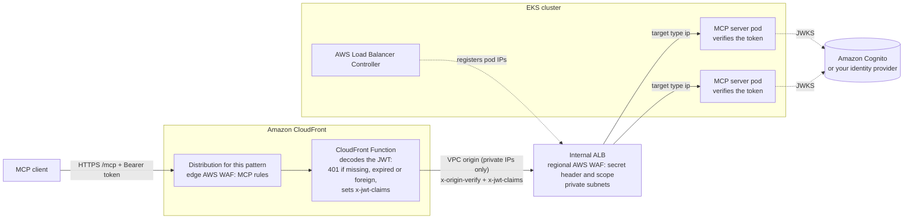

# Pattern 3: MCP server on Amazon EKS behind CloudFront

This pattern is guidance only. The stack deploys no distribution for it, because EKS clusters differ
too much for one template to fit: networking add-ons, ingress controllers, GitOps tooling and account
layout all vary. The design below reuses the pieces of [pattern 5](../5-alb/README.md): its own
CloudFront distribution serving MCP at `/mcp`, a VPC origin to an internal Application Load Balancer,
the shared edge web ACL and CloudFront Function, and a Cognito token verified at the origin. It
replaces the Fargate task with pods.

The recommended design keeps the origin private and puts AWS WAF at two layers:

- a **CloudFront VPC origin** to an **internal ALB** (or NLB) in private subnets, so the cluster has
  no public entry point;
- a **CloudFront-scope web ACL** on the distribution, which stops floods and bad bots at the edge;
- a **regional web ACL on the internal ALB**, which checks what reaches the VPC: the secret origin
  header, tighter per-path rate limits and rules that only make sense near the app.



## What CloudFront adds in front of EKS

- **No public entry into the VPC.** With a [VPC origin](https://docs.aws.amazon.com/AmazonCloudFront/latest/DeveloperGuide/private-content-vpc-origins.html),
  the load balancer lives in private subnets and has no public IP. The cluster needs no internet-facing
  load balancer at all.
- **Edge security.** AWS WAF at CloudFront drops floods, bad bots and malformed requests at the edge
  location, before they use cluster capacity. AWS Shield Standard covers the distribution at no charge.
- **Connection reuse.** MCP clients open a TLS connection to a nearby edge location. CloudFront keeps
  warm, long-lived connections to the origin, so the pods see fewer TLS handshakes.
- **Failover.** An origin group can send requests to a second cluster in another Region when the
  first returns 5xx or does not answer. Origin groups fail over only on `GET`, `HEAD` and `OPTIONS`,
  so MCP `POST` calls do not fail over this way. For `POST`, route between clusters with Route 53
  failover records behind one origin domain, or with an edge function.
- **Cached metadata.** The protected-resource metadata at `/.well-known/oauth-protected-resource/mcp`
  is the same for every client, and clients fetch it after every `401`. A `/.well-known/*` behavior
  with `CachingOptimized` serves it from the edge. `/mcp` stays on `CachingDisabled`.

## Expose the pods with the AWS Load Balancer Controller

Install the [AWS Load Balancer Controller](https://kubernetes-sigs.github.io/aws-load-balancer-controller/)
in the cluster. It creates and updates the load balancer and registers pod IPs as targets.

A VPC origin points at a load balancer **ARN**, so the ARN must be stable. There are two ways to get one.

### Option A (recommended): create the load balancer in IaC, bind it with `TargetGroupBinding`

Create the internal ALB, its listener, its target group (target type `ip`) and the VPC origin in the
same CDK, CloudFormation or Terraform code as the distribution. In the cluster, attach the pods to the
existing target group:

```yaml
apiVersion: elbv2.k8s.aws/v1beta1
kind: TargetGroupBinding
metadata:
  name: mcp-server
  namespace: mcp
spec:
  serviceRef:
    name: mcp-server        # a ClusterIP Service in front of the MCP pods
    port: 80
  targetGroupARN: <target group ARN from your IaC outputs>
  targetType: ip
  networking:
    ingress:
      - from:
          - securityGroup:
              groupID: <ALB security group ID>
        ports:
          - protocol: TCP
            port: 8000      # container port of the MCP server
```

The infrastructure team owns the load balancer and the CloudFront side. The application team owns
the Deployment and the Service. Deleting the Kubernetes objects never deletes the load balancer, so
the VPC origin never points at a missing ARN.

### Option B: let an Ingress create the ALB

```yaml
apiVersion: networking.k8s.io/v1
kind: Ingress
metadata:
  name: mcp-server
  namespace: mcp
  annotations:
    alb.ingress.kubernetes.io/scheme: internal
    alb.ingress.kubernetes.io/target-type: ip
    alb.ingress.kubernetes.io/load-balancer-name: mcp-internal   # fixed name, so you can look up the ARN
    alb.ingress.kubernetes.io/security-groups: <ALB security group ID>
    alb.ingress.kubernetes.io/manage-backend-security-group-rules: "true"
    alb.ingress.kubernetes.io/healthcheck-path: /health
    alb.ingress.kubernetes.io/load-balancer-attributes: idle_timeout.timeout_seconds=300
    alb.ingress.kubernetes.io/tags: auto-delete=no
spec:
  ingressClassName: alb
  rules:
    - http:
        paths:
          - path: /mcp
            pathType: Prefix
            backend:
              service:
                name: mcp-server
                port:
                  number: 80
```

This is quicker to start with, but the VPC origin then depends on an object the cluster can delete or
replace. If you choose it, set `load-balancer-name` and an `IngressGroup` so that the ALB keeps its
name, and create the VPC origin after the ALB exists.

### ALB or NLB

| | Internal ALB | Internal NLB |
|---|---|---|
| Kubernetes object | `Ingress` or `TargetGroupBinding` | `Service` of type `LoadBalancer` (`aws-load-balancer-scheme: internal`, `aws-load-balancer-nlb-target-type: ip`) or `TargetGroupBinding` |
| Layer 7 routing, header rules | Yes | No |
| Regional AWS WAF | Yes | No |
| Use it when | The MCP server runs straight behind the load balancer | An in-cluster gateway (Envoy Gateway, NGINX, Istio) already terminates HTTP and does routing, auth and limits |

A VPC origin accepts either. An NLB used as a VPC origin needs a security group attached at creation.

## Lock the origin so only CloudFront reaches it

Use all four layers. Each covers a gap in the one before.

1. **No public path.** The load balancer has scheme `internal` and sits in private subnets. Nothing on
   the internet can route to it.
2. **Security group.** Allow inbound traffic to the load balancer only from the CloudFront managed
   prefix list `com.amazonaws.global.cloudfront.origin-facing`, on the listener port, as pattern 5
   does (VPC origin traffic keeps CloudFront's source IPs). Pods allow inbound only from the load
   balancer security group (the `networking` block above, or
   [security groups for pods](https://docs.aws.amazon.com/eks/latest/userguide/security-groups-for-pods.html)).
3. **Secret origin header (ALB only).** The prefix list admits CloudFront as a whole, not only this
   distribution. Add a custom origin header in
   CloudFront, for example `x-origin-verify: <random value>`, and make the default listener action
   return `403`. Forward to the target group only on a listener rule that matches the header. Keep
   the value in AWS Secrets Manager and rotate it by adding the new value to the rule before you change
   CloudFront.

4. **Regional AWS WAF on the ALB.** Associate a regional web ACL with the internal ALB. Block
   requests that lack the secret header there instead of (or as well as) in the listener rule, as
   `OriginWaf` (`lib/waf.ts`) does, and require a scope in the `x-jwt-claims` header the edge
   function sets. Add per-path rate limits and managed rule groups. The CloudFront web ACL already ran at the edge,
   so this layer sees only traffic that came through CloudFront, plus anything inside the VPC that can
   reach the ALB. An NLB cannot have a web ACL; behind an NLB, the in-cluster gateway takes this role.

Kubernetes `NetworkPolicy` adds a fifth layer inside the cluster: deny traffic to the MCP pods from
other namespaces.

## Where authentication sits

The [MCP authorization spec](https://modelcontextprotocol.io/specification/latest/basic/authorization)
treats the MCP server as an OAuth 2.1 resource server: the client gets a token from an
authorization server and sends `Authorization: Bearer <token>` on every request. Follow the model
the other patterns use (see [Authentication](../../README.md#authentication)): a cheap filter at the
edge, and the signature checked at the origin with its native verifier.

| Where | How | Trade-off |
|---|---|---|
| Edge | The viewer-request CloudFront Function ([lib/viewer-request.js](../../lib/viewer-request.js)) decodes the token and answers `401` with `WWW-Authenticate: Bearer resource_metadata=...` for a missing, malformed, expired or foreign token. It sets `x-jwt-claims` to the decoded payload | Stops most bad traffic at the edge location at CloudFront Functions cost. It does not verify the signature: CloudFront Functions have no RSA verify |
| Regional WAF | A rule on the ALB's web ACL that requires the pattern's scope in `x-jwt-claims` | A resource-level check before the cluster does any work; a forged payload passes it and fails at the next layer |
| Load balancer | ALB JWT verification (`jwt-validation` action) on an HTTPS listener, or an in-cluster gateway behind an NLB | The native check, central for every service behind the load balancer. It needs an HTTPS listener, so an HTTPS VPC origin and a certificate for your own domain. The `authenticate-oidc` action is a browser redirect flow and does not suit MCP clients |
| MCP server | The SDK's bearer-auth middleware, a sidecar, or a check like [server/auth.js](../../server/auth.js) | Closest to the tools, can authorize per tool and per scope; every pod must be configured |

Give the pattern its own scope (the sample uses `mcp/<pattern>`) so a token for another MCP server is
refused. Serve `/.well-known/oauth-protected-resource/mcp` from the server, with `resource` set to
`https://<distribution>/mcp` (the edge function passes the viewer's host in `x-forwarded-host`) and
your issuer in `authorization_servers`, and cache it at CloudFront so that clients can discover the
authorization server.

## Rate limiting

- **At CloudFront.** A [rate-based rule](https://docs.aws.amazon.com/waf/latest/developerguide/waf-rule-statement-type-rate-based.html)
  in the CloudFront-scope web ACL counts requests per IP address, or per custom key such as the
  `Authorization` header or an API key header. Blocked requests never leave the edge location.
- **At the load balancer.** The regional web ACL on the ALB adds a second, tighter limit per path,
  counted after the edge has dropped the floods.
- **In the cluster.** For per-tenant or per-tool quotas, use the in-cluster gateway's rate limiter
  (Envoy, NGINX) or a limit in the server. These see the decoded token, which WAF does not.

## Configuration notes for MCP traffic

| Setting | Value | Why |
|---|---|---|
| Cache policy for `/mcp` | `CachingDisabled` | Every MCP call is a unique `POST` |
| Origin request policy | `AllViewerExceptHostHeader` | Forwards `Authorization`, `Mcp-Session-Id`, `Mcp-Protocol-Version` and `Accept`; the load balancer gets its own host name |
| Allowed methods | All (`GET`, `HEAD`, `OPTIONS`, `PUT`, `PATCH`, `POST`, `DELETE`) | Streamable HTTP uses `POST`, `GET` for the event stream and `DELETE` to end a session |
| Origin protocol | HTTPS with a certificate on the load balancer, or HTTP inside the VPC | Traffic from a VPC origin stays on the AWS network; use HTTPS when policy requires encryption to the target |
| Origin response timeout | 60 s or more | Tool calls that stream Server-Sent Events can go quiet between events; the timeout is the longest allowed silence between bytes |
| ALB idle timeout | At least the CloudFront origin response timeout | Otherwise the ALB closes quiet streams first |
| Server mode | Stateless Streamable HTTP | Any pod can answer any request, so the load balancer needs no sticky sessions. If the server keeps sessions (`Mcp-Session-Id`), store them outside the pod (for example Amazon ElastiCache), because MCP clients do not send ALB stickiness cookies reliably |
| Readiness probe and health check | The same path, for example `/health` | The controller removes a pod from the target group before Kubernetes stops it, so a rollout drops no calls |

## Pros and cons

**Pros**

- Uses the cluster, CI/CD and observability you already run. The MCP server is one more Deployment.
- No cold starts: pods are always running.
- Full control over the runtime, the sidecars and the network policy.

**Cons**

- The most to operate: cluster upgrades, node capacity, the controller and add-ons.
- Fixed cost while idle: EKS control plane, nodes or Fargate pods, and the load balancer.
- The VPC origin and the load balancer usually belong to a different team and tool than the pods,
  so the origin lock spans two code bases.

See [docs/comparison.md](../../docs/comparison.md) for how this compares with the other patterns.
