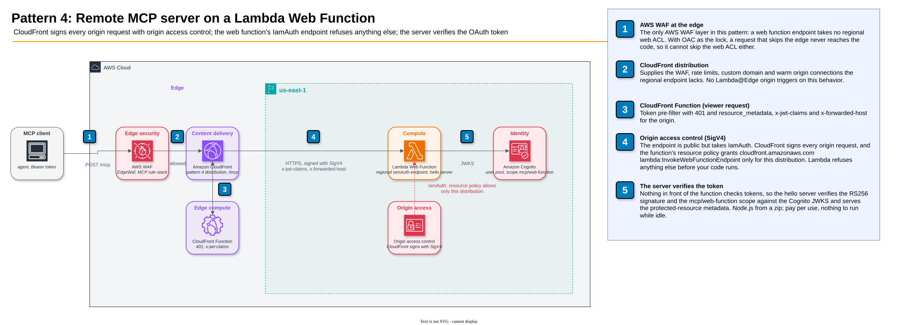

# Pattern 4: Lambda Web Function

Its own CloudFront distribution (`/mcp`) → CloudFront, signing with origin access control (OAC) → regional endpoint of a
[Lambda Web Function](https://docs.aws.amazon.com/lambda/latest/dg/web-functions.html) → the hello MCP server.

The strongest lock without a private network. The endpoint is public but takes `IamAuth`: CloudFront signs every origin
request with SigV4, and the function's resource policy grants the invoke permission only for this distribution, so Lambda
refuses anything else before your code runs. Nothing in front of the function checks tokens, so the server verifies them
itself. Pay per use with no VPC, load balancer or NAT. Node.js from a zip only, and one web ACL layer rather than two.

## Deployed resource details



1. **AWS WAF at the edge** inspects the `POST /mcp` before anything else runs: IP reputation, rate limits, body size,
   protocol version, tool allowlist, and SSRF, SQL and XSS in tool arguments. It is the only web ACL in this pattern.
2. **The CloudFront distribution** receives what the web ACL allowed and sends it to the web function's regional
   endpoint over HTTPS, signed with SigV4 by the origin access control (4). `/mcp` is not cached.
3. **The CloudFront Function** decodes the Bearer token and answers `401` at the edge for a missing, malformed, expired
   or foreign token. For a good token it writes the decoded claims into `x-jwt-claims`. It cannot verify the signature.
4. **Origin access control** makes CloudFront sign every origin request with SigV4 and keep the viewer's
   `Authorization` header, so the bearer token still reaches the server.
5. **The Lambda Web Function** takes `IamAuth` on its endpoint: Lambda checks the SigV4 signature against the resource
   policy (6) before the code runs, then the hello server verifies the token's RS256 signature and the `mcp/web-function`
   scope and answers the `tools/call`.
6. **The resource policy** grants `lambda:InvokeWebFunctionEndpoint` to `cloudfront.amazonaws.com` only when the
   request comes from this distribution (`aws:SourceArn`). Another distribution, even in the same account, is refused.
7. **The versioned S3 bucket** holds the server zip. The function's revision reads it with Lambda's own service
   principal.
8. **Amazon Cognito** issues the tokens and publishes the keys the server (5) verifies against.

### The edge

Global. Every request enters the edge location nearest the client, where TLS ends and where 1 to 4 run, before the
Region sees anything.

#### 1. AWS WAF web ACL `EdgeWaf`

- CloudFront scope, shared by every pattern distribution in the stack ([lib/waf.ts](../../lib/waf.ts)). The MCP rule
  stack is documented once, in the [root README](../../README.md#aws-waf-at-the-edge).
- AWS WAF has no regional association for a web function endpoint, so this is the only web ACL on this path. With OAC
  as the lock, a request that skips the edge never reaches the code, so it cannot skip the web ACL either.

#### 2. Amazon CloudFront distribution

- Origin: the web function's `HomeRegion` endpoint, whose hostname ends in `.lambda-web.us-east-1.on.aws`. A
  `MultiRegion` endpoint (`.lambda-web.global.on.aws`) needs a `sigv4a` OAC, and OAC is not supported when the global
  endpoint includes opt-in Regions.
- Uses `AllViewerExceptHostHeader`: the endpoint expects its own hostname and returns 404 otherwise.
- Lambda@Edge origin-request and origin-response triggers are not supported on this behavior. CloudFront Functions
  (viewer request and response) are, which is where the token pre-filter lives.
- If the server reads the viewer's `Authorization` header on `GET` or `HEAD`, add it to the cache policy, or CloudFront
  removes it. MCP calls are `POST`, so the hello path does not need this.
- What CloudFront adds here: the web ACL, rate limits, custom domain and warm origin connections the regional endpoint
  lacks.

#### 3. CloudFront Function (viewer request)

- [lib/viewer-request.js](../../lib/viewer-request.js). Decodes the token and answers `401` with
  `WWW-Authenticate: Bearer resource_metadata=...`. Sets `x-jwt-claims` and `x-forwarded-host`. There is no regional
  web ACL on this pattern, so nothing matches on `x-jwt-claims` before the server.

#### 4. Origin access control

- `AWS::CloudFront::OriginAccessControl` with origin type `lambda`, signing protocol `sigv4`, signing behavior
  `always-amz-auth`. Web function origins support only `always-amz-auth`: CloudFront signs every request and keeps the
  viewer's `Authorization` header. Follows [Restrict access to an AWS Lambda Web Function origin](https://docs.aws.amazon.com/AmazonCloudFront/latest/DeveloperGuide/private-content-restricting-access-to-lambda-web.html).

### The Region (us-east-1)

#### 5. Lambda Web Function

- All native CloudFormation resources, no custom resource: `AWS::Lambda::WebFunction` (the function container),
  `AWS::Lambda::WebFunctionRevision` (immutable code and configuration: the `server/` code as a zip on `nodejs24.x`,
  pinned to the object version the deployment wrote) and `AWS::Lambda::WebFunctionEndpoint` (`HomeRegion` endpoint
  `mcp`, auth type `IamAuth`, 100 % of traffic on the revision).
- The endpoint uses `IamAuth`, so Lambda rejects any request without a valid SigV4 signature before the code runs. The
  endpoint stays publicly resolvable. The lock is IAM, not the network. No shared secret is involved.
- Web functions run a zip on a managed Node.js runtime, not a container image. The revision ships the same `server.js`
  the other patterns run in the shared image. The runtime loads it through `AWS_LAMBDA_NODEJS_ENTRYPOINT`, and the server
  listens on the address in `AWS_LAMBDA_HTTP_ENDPOINT`. No Lambda Web Adapter is needed.
- A code change creates a new revision (its build configuration is create-only), CloudFormation points the endpoint at
  it, then deletes the old one. The endpoint domain name does not change.
- Authentication sits in the server (`JWT_VERIFY=true`, [server/auth.js](../../server/auth.js)): RS256 signature
  against the user pool's JWKS, issuer, token type and the scope `mcp/web-function`. It also serves the
  protected-resource metadata. See [Authentication](../../README.md#authentication).
- For a ceiling at the origin, set `ThrottleConfig.RateLimit` (requests per second) and `ScalingConfig.MaxEnvironments`
  on the endpoint. This sample leaves both unset.

#### 6. Lambda resource policy

- `AWS::Lambda::ResourcePolicy` granting `lambda:InvokeWebFunctionEndpoint` on the endpoint ARN to the CloudFront
  service principal, with an `aws:SourceArn` condition naming this distribution.

#### 7. Amazon S3 code bucket

- Versioned. Lambda reads the zip with its own service principal (`lambda.amazonaws.com`), so the bucket policy grants
  it `s3:GetObject` and `s3:GetObjectVersion`, scoped to this function's revisions. The CDK bootstrap bucket cannot
  carry that policy, which is why the stack creates its own.

#### 8. Amazon Cognito user pool

- The one issuer for the stack ([lib/auth.ts](../../lib/auth.ts)). This pattern's scope is `mcp/web-function`. The
  stack outputs `TokenUrl`, `UserPoolId` and `ClientId`. The [root README](../../README.md#deploy) shows how to get a
  token.

## Deploy with CloudFormation

[`cfn/web-function.yaml`](../../cfn/web-function.yaml) takes the server zip as parameters, as a stack cannot create the
bucket and upload to it before the revision reads it. Create a versioned bucket whose policy lets Lambda read the zip
for this function's revisions, upload the zip, then deploy from the repository root:

```bash
export AWS_REGION=us-east-1
account=$(aws sts get-caller-identity --query Account --output text)
bucket=cloudfront-mcp-code-$account
aws s3api create-bucket --bucket "$bucket"
aws s3api put-bucket-versioning --bucket "$bucket" --versioning-configuration Status=Enabled
aws s3api put-bucket-policy --bucket "$bucket" --policy '{"Version":"2012-10-17","Statement":[{"Effect":"Allow",
  "Principal":{"Service":"lambda.amazonaws.com"},"Action":["s3:GetObject","s3:GetObjectVersion"],
  "Resource":"arn:aws:s3:::'"$bucket"'/*","Condition":{"ArnLike":{"aws:SourceArn":
  "arn:aws:lambda:us-east-1:'"$account"':web-function/CloudFrontMcpWebFunction-hello/revision/*"}}}]}'
(cd server && npm ci --omit=dev && zip -qr ../hello.zip server.js auth.js package.json node_modules)
version=$(aws s3api put-object --bucket "$bucket" --key hello.zip --body hello.zip --query VersionId --output text)
aws cloudformation deploy --template-file cfn/web-function.yaml --stack-name cloudfront-mcp-web-function \
  --parameter-overrides CodeBucket="$bucket" CodeVersionId="$version" --capabilities CAPABILITY_IAM --tags auto-delete=no
```

New code is a new object version: upload it and deploy again with its `CodeVersionId`. The stack outputs
`WebFunctionMcp` and, for a token with scope `mcp/web-function`, `TokenUrl`, `UserPoolId` and `ClientId`.

## Trade-offs

- Pay per use and nothing to run while idle: no VPC, no load balancer, no NAT.
- The strongest lock without a private network: IAM, checked by Lambda before your code runs.
- Cold starts on a new execution environment.
- Node.js only, from a zip. The container image used by the other patterns does not run here.
- One web ACL layer instead of two, and no Lambda@Edge origin triggers.
