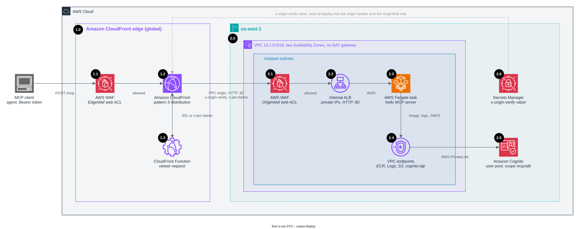

# Pattern 5: Application Load Balancer

Its own CloudFront distribution (`/mcp`) → CloudFront VPC origin → internal Application Load Balancer → one AWS Fargate task, in a VPC with two
Availability Zones.



## How the origin is locked down

- The ALB is internal: it has only private IPs, so it cannot be reached from the internet at all. CloudFront reaches it
  through a [VPC origin](https://docs.aws.amazon.com/AmazonCloudFront/latest/DeveloperGuide/private-content-vpc-origins.html),
  which places elastic network interfaces in the VPC.
- The ALB security group allows port 80 only from the CloudFront managed prefix list
  `com.amazonaws.global.cloudfront.origin-facing` (VPC origin traffic keeps CloudFront's source IPs). The task security
  group allows traffic from the ALB only.
- A regional AWS WAF web ACL on the ALB blocks every request without CloudFront's secret `x-origin-verify` header, so
  a workload inside the VPC cannot skip the edge rules either.

## AWS WAF at two layers

| Layer | Web ACL | Rules |
|---|---|---|
| CloudFront | `EdgeWaf` (CloudFront scope, `lib/waf.ts`) | MCP rules shared by every pattern distribution, see below |
| ALB | `OriginWaf` (regional, shared with the AgentCore Gateway, and the pattern 2 REST API stage) | Label the tool, block destructive SQL, SSRF targets, SQLi and XSS in tool arguments, then allow only requests with the secret header and an `mcp/` scope in `x-jwt-claims` (or the protected-resource metadata path, which carries no token); default block |

The edge rule stack (the blog's nine use cases plus the IP reputation list and an `initialize` rate limit, their order and
where this sample departs from the blog) is documented once, in the [root README](../../README.md#aws-waf-at-the-edge).
What is specific to this pattern:

- The ALB is the only origin here that can take a web ACL, so `OriginWaf` sits on it. It repeats the tool labels and
  the four argument rules (destructive SQL, SSRF, SQLi, XSS) ahead of the secret-header allow, so a caller inside the
  VPC cannot skip them.
- An ALB inspects only the first 8 KB of a request body, and `OriginWaf` has no size preflight, so its argument rules
  use `OversizeHandling: MATCH` and block a body they cannot fully see. The edge web ACL inspects 32 KB and has the
  preflight, so a legitimate body between 8 and 32 KB is blocked here; raise the argument sizes your tools accept with
  that in mind, or move argument inspection to the edge only.
- Blocks from `OriginWaf` are plain 403s, not the JSON-RPC error the edge returns, because they are never meant to be
  seen by a client that came through CloudFront.

## Networking

- No NAT gateway. The tasks run in isolated subnets and pull the image through VPC endpoints for Amazon ECR (API and
  Docker), Amazon CloudWatch Logs, and an Amazon S3 gateway endpoint; a `cognito-idp` endpoint serves the JWKS.
- The VPC (`10.1.0.0/16`, `lib/vpc.ts`) is shared with pattern 2, whose internal NLB and `execute-api` endpoint sit in
  the same isolated subnets.
- CloudFront VPC origins require an internet gateway on the VPC, so the VPC also has public subnets with nothing in them.
- CloudFront talks to the ALB over HTTP inside the AWS network. Use HTTPS with a certificate for your own domain on the
  ALB if your compliance rules require encryption to the origin.

## Authentication

In the hello server, which verifies each Cognito access token (`JWT_VERIFY=true`,
[server/auth.js](../../server/auth.js)) and fetches the user pool's keys through a `cognito-idp` interface endpoint,
since the VPC has no NAT. Two caveats:

- ALB JWT verification (`ListenerAction.authenticateJwt`) would be the native check, but it works only on HTTPS
  listeners: on this HTTP listener the API rejects it with "Actions of type 'jwt-validation' are supported only on
  HTTPS listeners". An HTTPS VPC origin needs a certificate for a domain you own. With one, move the check to the ALB.
- The `cognito-idp` endpoint is not offered in every Availability Zone, so `lib/vpc.ts` pins the VPC to AZs that have
  it. AZ names map to different physical AZs in each account; check yours before you deploy.

The CloudFront Function in front answers `401` for a missing, expired or foreign token, and `OriginWaf` on the ALB
requires an `mcp/` scope in the decoded claims; the server then requires `mcp/alb`. See [Authentication](../../README.md#authentication).

## Deploy with CloudFormation

Push the hello image first ([Deploy with CloudFormation](../../README.md#deploy-with-cloudformation) in the root
README has the commands), then deploy [`cfn/alb.yaml`](../../cfn/alb.yaml) from the repository root:

```bash
aws cloudformation deploy --region us-east-1 --template-file cfn/alb.yaml --stack-name cloudfront-mcp-alb \
  --parameter-overrides ImageRepository=cloudfront-mcp-hello --capabilities CAPABILITY_IAM --tags auto-delete=no
```

The stack outputs `AlbMcp` and, for a token with scope `mcp/alb`, `TokenUrl`, `UserPoolId` and `ClientId`.

## Trade-offs

- The common production setup for container workloads, and no public origin to protect.
- Costs while idle: the Fargate task, the ALB and four interface endpoints in two Availability Zones.
