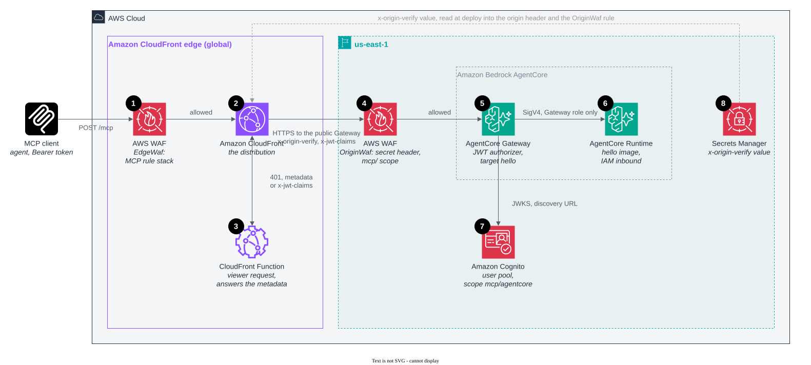

# Amazon Bedrock AgentCore behind CloudFront (managed MCP endpoint)

In this pattern, CloudFront sends requests to an Amazon Bedrock AgentCore Gateway, and the Gateway calls an AgentCore
Runtime that runs the hello image.

This is the managed path. You run nothing and you need no VPC. The Gateway is a public endpoint, so a regional AWS WAF
web ACL on it accepts only requests that carry CloudFront's secret header. The Gateway's own JWT authorizer verifies the
token before it calls any target, and the Runtime accepts only the Gateway's role. The first call after an idle period
sees a cold start, and tool names arrive as `<target>___<tool>`, for example `hello___hello`.

The following diagram shows the resources that the stack creates, numbered as in the list that follows it.



1. **AWS WAF at the edge** runs the MCP rule stack before anything else. For the rules, see
   [AWS WAF at the edge](../../README.md#aws-waf-at-the-edge). The tool allowlist accepts `hello___hello`, the
   Gateway's name for the tool. The Gateway is configured for protocol versions `2025-06-18` and `2025-11-25`, the
   ones that the edge lets through. Its default is `2025-03-26` only.
2. **The CloudFront distribution** forwards to the Gateway's public hostname,
   `<gateway-id>.gateway.bedrock-agentcore.<region>.amazonaws.com`, over HTTPS, and adds the secret `x-origin-verify`
   header (8). CloudFront gives this managed endpoint a custom domain and an edge web ACL, which it has neither of on
   its own.
3. **The CloudFront Function** decodes the Bearer token and answers `401` at the edge for a missing, malformed, expired
   or foreign token. It also answers `GET /.well-known/oauth-protected-resource/mcp` itself. The Gateway's own
   document names the Gateway's hostname as `resource`, and an MCP client must refuse a document whose `resource`
   differs from the URL that it called.
4. **AWS WAF on the Gateway** (`OriginWaf`) is the origin lock. The Gateway endpoint is public and takes no security
   group or resource policy that can name CloudFront, so the shared secret that this web ACL checks is what keeps
   direct callers out. A call straight to the Gateway gets a 403 response and never reaches the Runtime. The web ACL
   also requires an `mcp/` scope in `x-jwt-claims`. A private alternative exists but isn't built here. The Gateway has
   an AWS PrivateLink endpoint, and a resource policy on `aws:SourceVpce` can close the public path, but the VPC origin
   then needs a load balancer in front of the endpoint.
5. **The AgentCore Gateway** verifies the token's signature and the `mcp/agentcore` scope with its Cognito authorizer
   (`GatewayAuthorizer.usingCognito`, allowing only the stack's app client), then calls its one MCP server target,
   `hello`, and signs the call with its own role.
6. **The AgentCore Runtime** runs the hello image with the MCP protocol (`POST :8000/mcp`). Its inbound authorizer is
   IAM: only the Gateway's role, with `bedrock-agentcore:InvokeAgentRuntime`, can invoke it. It starts a session on
   demand, which is why the first call sees a cold start.
7. **Amazon Cognito** issues the tokens and publishes the discovery document and keys the Gateway verifies against.
8. **Secrets Manager** holds the random `x-origin-verify` value. At deploy time, the stack reads it into the origin
   header (2) and the `OriginWaf` rule (4). To rotate it, update the secret and deploy again.

## Deploy

Install the dependencies once at the repository root, then deploy from this directory. The app builds a container
image, so it needs Docker.

```bash
npm ci
cd patterns/pattern-mcp-agentcore-cloudfront
npx cdk deploy
```

The Runtime, the Gateway, and the CloudFront Function take their names from the stack name. Keep the stack name to 40
characters, because a Runtime name holds 48 and a function name holds 64. To call the server, get a token with the
`mcp/agentcore` scope and call `hello___hello`, as shown in [Getting a token](../../README.md#getting-a-token).
