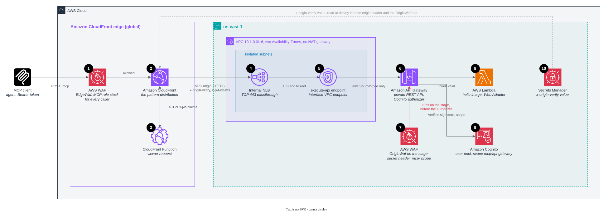

# Amazon API Gateway behind CloudFront (self-managed MCP server)

In this pattern, CloudFront uses a VPC origin to reach an internal Network Load Balancer. The load balancer passes the
request to an `execute-api` VPC endpoint, which reaches a private API Gateway REST API. The API invokes an AWS Lambda
function that runs the hello image with Lambda Web Adapter.

This pattern makes a private API reachable from the internet without exposing it. The REST API has no public endpoint.
CloudFront reaches it through a VPC origin, an internal NLB, and an interface VPC endpoint, and TLS runs the whole way.
A Cognito authorizer on every method verifies the token, so Lambda never runs for a bad one. The private path adds a
fixed cost for the NLB and the endpoint in two Availability Zones, and the REST API's 29-second timeout rules out long
SSE streams.

The following diagram shows the resources that the stack creates, numbered as in the list that follows it.



1. **AWS WAF at the edge** runs the MCP rule stack before anything else. For the rules, see
   [AWS WAF at the edge](../../README.md#aws-waf-at-the-edge). Floods stop here, before they can cost a Lambda
   invocation.
2. **The CloudFront distribution** sends allowed requests through a
   [VPC origin](https://docs.aws.amazon.com/AmazonCloudFront/latest/DeveloperGuide/private-content-vpc-origins.html)
   to the NLB over HTTPS, and adds the secret `x-origin-verify` header (10). The origin domain is the API's own
   hostname, `<api-id>.execute-api.<region>.amazonaws.com`. CloudFront validates the endpoint's certificate against
   that name, and the Host header routes the request to this API. The hostname has no public DNS record.
3. **The CloudFront Function** decodes the Bearer token and answers `401` at the edge for a missing, malformed, expired
   or foreign token. For a good token it sets `x-jwt-claims` for the regional web ACL (7) and `x-forwarded-host` for
   the server's metadata.
4. **The internal NLB** has private IPs only. Its security group admits port 443 only from the CloudFront managed prefix
   list `com.amazonaws.global.cloudfront.origin-facing` because VPC origin traffic keeps CloudFront's source IP addresses. The
   NLB passes TCP 443 straight through, so TLS runs from CloudFront to the endpoint without interruption. CloudFormation
   doesn't expose the endpoint's IP addresses, so a small inline Lambda function in `endpoint-ips.js` looks them up once
   as a custom resource.
5. **The `execute-api` VPC endpoint** is the only way into the API. The API's resource policy allows
   `execute-api:Invoke` only from this endpoint (`aws:SourceVpce`), and the public `execute-api` hostname answers 403. Its security group
   admits only the NLB.
6. **The private REST API** runs the regional web ACL (7), then its Cognito user pools authorizer, which verifies the
   token's signature and the `mcp/api-gateway` scope on every method before Lambda is invoked. Only
   `GET /.well-known/oauth-protected-resource/mcp` has no authorizer. You can add stage and usage-plan throttling for each API key
   here.
7. **AWS WAF on the stage** (`OriginWaf`) admits only requests with the secret header and an `mcp/` scope in
   `x-jwt-claims`. The security groups and the resource policy prove that a request came from CloudFront through this
   endpoint. They don't prove that it came through this distribution and its edge rules. This web ACL does, and a
   workload inside the VPC that calls the NLB directly meets it too. An NLB can't take a web ACL, so the stage is where
   it lives.
8. **AWS Lambda** runs the same arm64 hello image as the other patterns, through Lambda Web Adapter, and answers the
   `tools/call`. REST APIs time out at 29 seconds and buffer responses, so the server answers with JSON rather than a
   long-lived SSE stream. A container image starts more slowly than a zip handler.
9. **Amazon Cognito** issues the tokens and publishes the keys the authorizer verifies against.
10. **Secrets Manager** holds the random `x-origin-verify` value. At deploy time, the stack reads it into the origin
    header (2) and the `OriginWaf` rule (7). To rotate it, update the secret and deploy again.

The VPC (`10.1.0.0/16`, two Availability Zones) has isolated subnets and no NAT gateway, because nothing in it needs
egress.

## Deploy

Install the dependencies once at the repository root, then deploy from this directory. The app builds a container
image, so it needs Docker.

```bash
npm ci
cd patterns/pattern-mcp-api-gateway-cloudfront
npx cdk deploy
```

To call the server, get a token with the `mcp/api-gateway` scope and call `hello`, as shown in
[Getting a token](../../README.md#getting-a-token).
