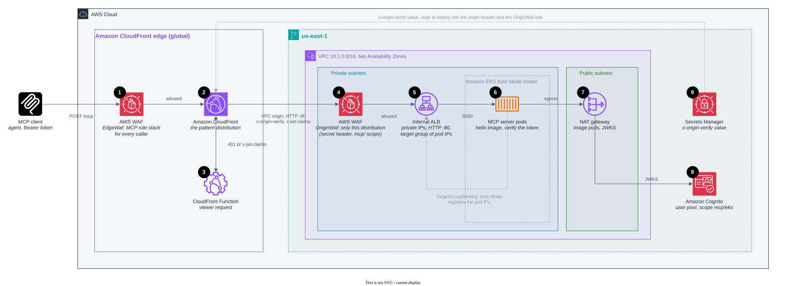

# Amazon EKS behind CloudFront (self-managed MCP server)

In this pattern, CloudFront uses a VPC origin to reach an internal Application Load Balancer, and the load balancer
sends requests to MCP server pods on an Amazon EKS Auto Mode cluster. The pods run in private subnets behind one NAT
gateway.

This is the shape for teams that run containers on Kubernetes, and it has no public origin to protect. The ALB has only
private IP addresses. Its security group admits only CloudFront's origin-facing addresses, and it carries the regional
web ACL, so a workload inside the VPC can't skip the edge rules either. EKS Auto Mode provisions the nodes and runs the
load balancer controller, so the stack installs no add-ons. The cluster, its nodes, the ALB, and the NAT gateway cost
money while idle. Deployment takes about 20 minutes.

The following diagram shows the resources that the stack creates, numbered as in the list that follows it.



1. **AWS WAF at the edge** runs the MCP rule stack before anything else, so floods and malformed requests never use
   cluster capacity. For the rules, see [AWS WAF at the edge](../../README.md#aws-waf-at-the-edge).
2. **The CloudFront distribution** sends allowed requests through a
   [VPC origin](https://docs.aws.amazon.com/AmazonCloudFront/latest/DeveloperGuide/private-content-vpc-origins.html)
   to the ALB over HTTP on port 80 inside the AWS network, and adds the secret `x-origin-verify` header (9). If your
   rules require encryption to the origin, use HTTPS with a certificate for your own domain.
3. **The CloudFront Function** decodes the Bearer token and answers `401` at the edge for a missing, malformed, expired
   or foreign token. For a good token it sets `x-jwt-claims` for the regional web ACL (4) and `x-forwarded-host` for
   the server's metadata.
4. **AWS WAF on the ALB** (`OriginWaf`) admits only requests with the secret header and an `mcp/` scope in
   `x-jwt-claims`. The security group proves that a request came from CloudFront. This web ACL proves that it came
   through this distribution and its edge rules, and it catches anything inside the VPC that calls the ALB directly. An
   ALB inspects only the first 8 KB of a body, and this web ACL has no size preflight, so its argument rules block a
   body that they can't fully see. If the network lock is enough for you, an ALB listener rule that checks the header
   does the same job at no extra charge.
5. **The internal ALB** has private IP addresses only. Its security group admits port 80 only from the CloudFront
   managed prefix list `com.amazonaws.global.cloudfront.origin-facing`. The cluster security group admits port 8000
   only from the ALB. The stack creates the ALB, its listener, and a target group of type `ip`, so the VPC origin
   points at an ARN that this stack owns. ALB JWT verification (`authenticateJwt`) is the native token check, but it
   works only on HTTPS listeners, which need a certificate for your own domain. If you have one, move the check here.
6. **The MCP server pods** are a two-replica Deployment of the hello image in the `mcp` namespace, with a ClusterIP
   Service and a readiness probe on `/`. The image is built for amd64, which Auto Mode's general-purpose node pool
   runs. A `TargetGroupBinding` (`eks.amazonaws.com/v1`), served by Auto Mode's built-in load balancer controller,
   registers the pod IP addresses in the stack's target group. Deleting the Kubernetes objects never deletes the ALB.
   The server verifies each token's RS256 signature and the `mcp/eks` scope itself, in
   [server/auth.js](../../server/auth.js). The server runs stateless Streamable HTTP, so any pod can answer any call
   and the ALB needs no stickiness.
7. **The NAT gateway** gives the private subnets egress. Nodes pull the image from Amazon ECR through it, and the pods
   fetch the Cognito keys through it. The cluster runs Kubernetes 1.34 with the `system` and `general-purpose` node
   pools. The CDK applies the manifests through its kubectl provider.
8. **Amazon Cognito** issues the tokens and publishes the keys the pods verify against.
9. **Secrets Manager** holds the random `x-origin-verify` value. At deploy time, the stack reads it into the origin
   header (2) and the `OriginWaf` rule (4). To rotate it, update the secret and deploy again.

## Deploy

Install the dependencies once at the repository root, then deploy from this directory. The app builds a container
image, so it needs Docker.

```bash
npm ci
cd patterns/pattern-mcp-eks-cloudfront
npx cdk deploy
```

To call the server, get a token with the `mcp/eks` scope and call `hello`, as shown in
[Getting a token](../../README.md#getting-a-token). You don't need `kubectl` access to the cluster. To look inside,
create an access entry for your IAM principal with `aws eks create-access-entry`, then run
`aws eks update-kubeconfig`.
