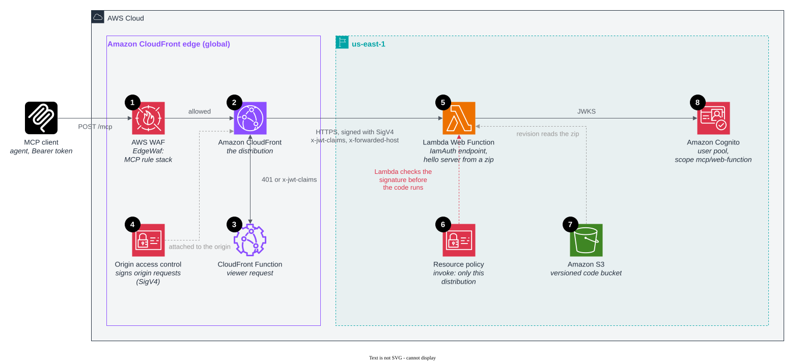

# Lambda Web Function behind CloudFront

CloudFront, signing with origin access control (OAC) → regional endpoint of a
[Lambda Web Function](https://docs.aws.amazon.com/lambda/latest/dg/web-functions.html) → the hello MCP server from a zip.

The strongest lock without a private network. The endpoint is public but takes `IamAuth`: CloudFront signs every origin
request with SigV4, and the function's resource policy grants the invoke permission only for this distribution, so
Lambda refuses anything else before your code runs. Nothing in front of the function checks tokens, so the server
verifies them itself. Pay per use with no VPC, load balancer or NAT. Node.js from a zip only, and one web ACL layer
rather than two.



1. **AWS WAF at the edge** runs the MCP rule stack ([root README](../../README.md#aws-waf-at-the-edge)). It is the only
   web ACL in this pattern: AWS WAF has no regional association for a web function endpoint. With OAC as the lock, a
   request that skips the edge never reaches the code, so it cannot skip the web ACL either.
2. **The CloudFront distribution** sends allowed requests to the function's `HomeRegion` endpoint
   (`*.lambda-web.us-east-1.on.aws`) over HTTPS. A `MultiRegion` endpoint would need a `sigv4a` OAC. Lambda@Edge
   origin triggers are not supported on this origin type. CloudFront Functions are.
3. **The CloudFront Function** decodes the Bearer token and answers `401` at the edge for a missing, malformed, expired
   or foreign token, and sets `x-jwt-claims` and `x-forwarded-host`.
4. **Origin access control** (origin type `lambda`, signing protocol `sigv4`, behavior `always-amz-auth`, the only one
   web function origins support) makes CloudFront sign every origin request and keep the viewer's `Authorization`
   header, so the bearer token still reaches the server. See
   [Restrict access to an AWS Lambda Web Function origin](https://docs.aws.amazon.com/AmazonCloudFront/latest/DeveloperGuide/private-content-restricting-access-to-lambda-web.html).
5. **The Lambda Web Function** is three native resources: `AWS::Lambda::WebFunction`, a `WebFunctionRevision` (the
   `server/` code as a zip on `nodejs24.x`, pinned to an object version) and a `WebFunctionEndpoint` with `IamAuth`.
   Lambda checks the SigV4 signature against the resource policy (6) before the code runs. The runtime loads
   `server.js` through `AWS_LAMBDA_NODEJS_ENTRYPOINT` and the server listens on `AWS_LAMBDA_HTTP_ENDPOINT`. No Lambda
   Web Adapter is needed. The server then verifies the token's RS256 signature and the `mcp/web-function` scope
   ([server/auth.js](../../server/auth.js)) and answers the `tools/call`. A code change is a new revision. The endpoint
   domain does not change. `ThrottleConfig` and `ScalingConfig` on the endpoint can cap the origin. Both are unset here.
6. **The resource policy** grants `lambda:InvokeWebFunctionEndpoint` to `cloudfront.amazonaws.com` only when
   `aws:SourceArn` is this distribution. Another distribution, even in the same account, is refused.
7. **The versioned S3 bucket** holds the zip. Lambda reads it with its own service principal, so the bucket policy
   grants `s3:GetObject` and `s3:GetObjectVersion` scoped to this function's revisions. The CDK bootstrap bucket cannot
   carry that policy, which is why the stack creates its own.
8. **Amazon Cognito** issues the tokens and publishes the keys the server verifies against.

## Deploy

```bash
npm ci                                          # at the repository root, once
cd patterns/pattern-mcp-web-function-cloudfront
npx cdk deploy
```

No Docker needed. Then get a token with scope `mcp/web-function` and call `hello` as in the
[root README](../../README.md#deploy).
